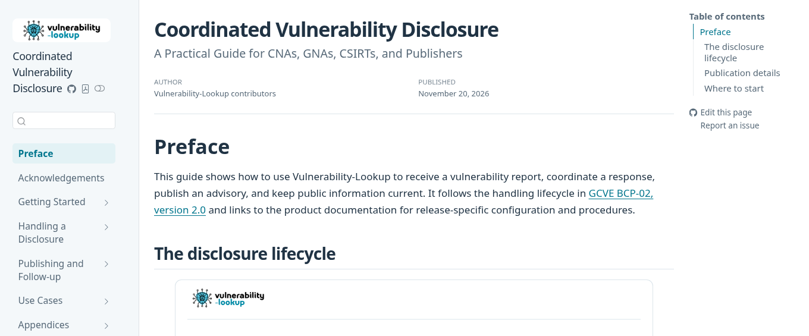
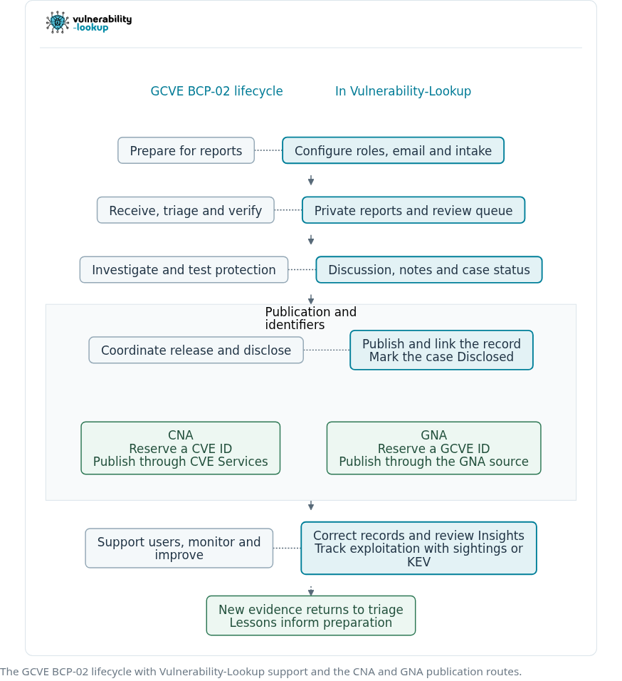

# Coordinated Vulnerability Disclosure

*A Practical Guide for CNAs, GNAs, CSIRTs, and Publishers* is an operational book about using Vulnerability-Lookup to handle and publish coordinated vulnerability disclosures. Its lifecycle follows [GCVE BCP-02](https://gcve.eu/bcp/gcve-bcp-02/). Its Quarto layout follows the [MISP Book](https://github.com/MISP/misp-book/), with chapters in their own directories and grouped into parts in `_quarto.yml`.

[Read the book online](https://vulnerability-lookup.github.io/cvd-book/) · [Download the PDF](https://vulnerability-lookup.github.io/cvd-book/cvd-book.pdf)

[](https://vulnerability-lookup.github.io/cvd-book/)

[](https://vulnerability-lookup.github.io/cvd-book/#the-disclosure-lifecycle)

## Build and preview

Install the [Quarto CLI](https://quarto.org/docs/get-started/). The publishing workflow uses Quarto 1.11.9, which includes the Typst compiler for the PDF export. Run these commands from the repository root.

```sh
quarto render
quarto preview --to html --no-browser
```

The render writes `_book/index.html` and `_book/cvd-book.pdf`. The preview server prints its local address and rebuilds HTML pages as you edit. A Vulnerability-Lookup instance is useful for trying the workflows in the guide. The book itself renders without one.

The web theme and PDF layout are adapted from the MISP Book. The source, licenses, and font provenance are documented in [Book styling and assets](assets/README.md).

## Publish to GitHub Pages

The `Publish book` workflow builds HTML and PDF on pull requests. On a push to `main`, or when run manually on `main`, it publishes both to the [GitHub Pages site](https://vulnerability-lookup.github.io/cvd-book/).

In repository **Settings → Pages**, set **Build and deployment → Source** to **GitHub Actions** when setting up another repository with this workflow.

## Add a chapter

1. Create a `topic-name/index.qmd` file and give it a level-one heading.
2. Add the file under the relevant part in `_quarto.yml` and use relative `.qmd` links between chapters.
3. Cite the relevant BCP section and Vulnerability-Lookup documentation. Use fictional case data and note the Vulnerability-Lookup release and configuration when documenting version-specific behavior.
4. Render the book and check the chapter in the sidebar along with its links and headings.
