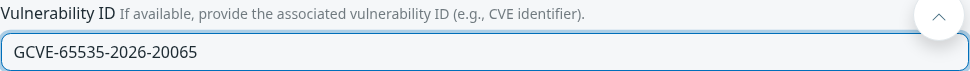
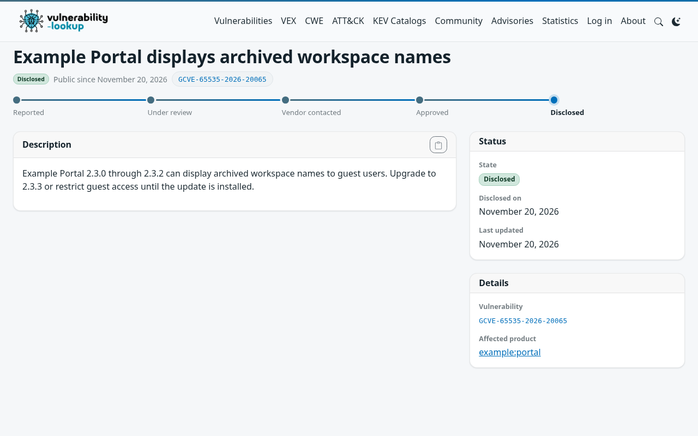
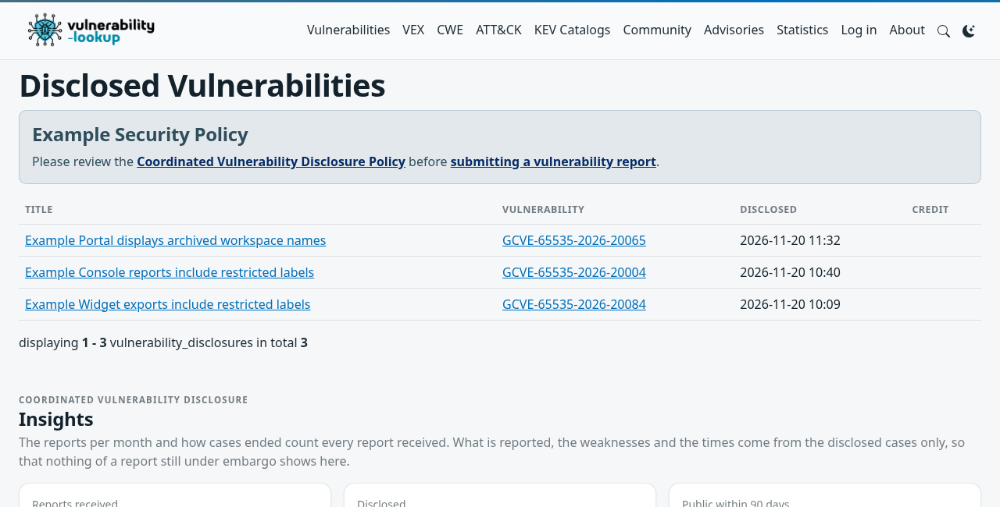
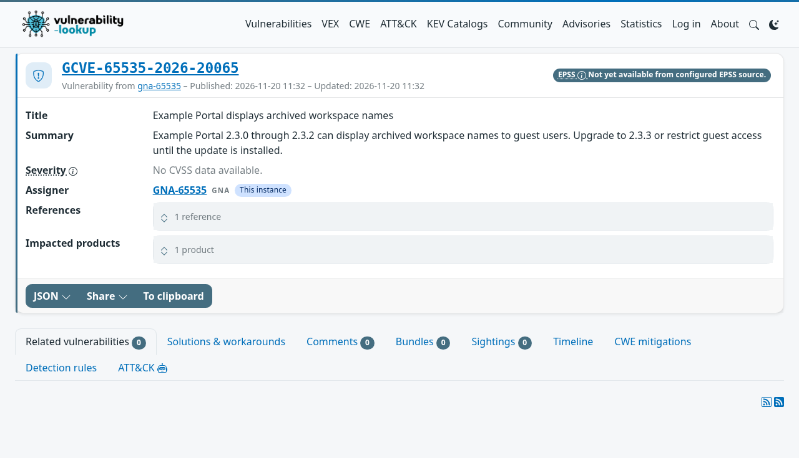
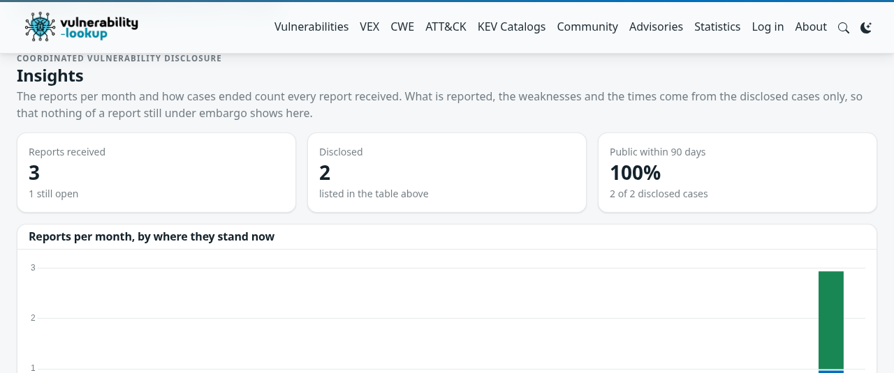

# Publish the advisory and follow up

## Release together

Review the [release checklist](../checklists/index.qmd) with the coordinator and publication operator. Prepare an advisory that identifies the affected product and versions, explains user impact, and tells readers how to obtain and verify a fix or apply a mitigation. If a fix is pending, state what users can do now and where to find updates. Include the public identifiers, relevant references, and the credit agreed with the reporter.

Verify the vendor, product, and repository when adding CPEs to the structured vulnerability record. [Choose a CPE for the advisory](../vulnerability-record-quality/index.qmd#look-up-an-existing-cpe)

1. Publish the public vulnerability record through the agreed route and verify the identifier. Link it in the public advisory and link the record back to the advisory. The Example Portal walkthrough uses the GCVE test namespace. Use your agreed local identifier, CNA, GNA or partner publication route in production. [Local publication and CNA publication](../cna-publication/index.qmd#start-with-local-publication) · [GNA publication](../gna-publication/index.qmd#prepare-validate-and-publish-the-record)
2. On the case's **Review** tab, check the title, description, affected product, and credit settings. Enter the public **Vulnerability ID** and set **State** to **Disclosed**. Select **Save review** at the coordinated release time. The transition replaces the planned date with the actual disclosure time and the reporter receives a review notification. [Publishing the vulnerability](https://www.vulnerability-lookup.org/documentation/cvd.html#publishing-the-vulnerability)

   {fig-alt="The Review form for Example Portal contains the published GCVE identifier in the Vulnerability ID field."}

## Verify as a reader

In a signed-out session, open the advisory, public record, and disclosure listing at `/disclosures/`. Check that the identifiers and version ranges agree, the update links work, and the public pages contain only approved details. If you distribute through a feed or API, verify the same record there. Give the reporter and participating teams the public links. [Feed syndication](https://www.vulnerability-lookup.org/documentation/feeds.html) · [API](https://www.vulnerability-lookup.org/documentation/api.html)

{fig-alt="The public Example Portal case shows Disclosed, the linked GCVE identifier, and the approved description and update guidance."}

{fig-alt="The signed-out Public vulnerability disclosures list contains the Example Portal case and its GCVE identifier."}

Follow the identifier link from the public disclosure to the vulnerability record. Confirm the agreed credit is displayed and that the reporter's account is hidden for an anonymous case. Check that the confidential details, discussion, notes, and external reference are restricted even after release.

{fig-alt="The Example Portal vulnerability record shows the test GCVE ID and the guidance to update to version 2.3.3."}

## Keep the record current

Assign someone to handle feedback and corrections. If the affected scope or fix changes, update the advisory and the published vulnerability record, record what changed and when, and notify the other publishers. Route substantive new evidence back through triage. Review the case afterward and turn any missed handoffs into specific changes to the team's process.

Use **Insights** below **Admin → Disclosures** to review response and release times. The public **Insights** at `/disclosures/` shows aggregate counts across cases and statistics based on disclosed case content. The public figures refresh every ten minutes. Upcoming titles and private queue indicators remain in the admin view. [Monitor CVD activity](../monitor-cvd/index.qmd)

{fig-alt="The signed-out Insights section displays aggregate reports received, open and disclosed."}

When you verify exploitation and can share the finding, publish the evidence and affected scope as a separate assertion in your [local KEV catalogue](../kev-catalogue/index.qmd).

**BCP-02** · [Publishing Advisories](https://gcve.eu/bcp/gcve-bcp-02/#publishing-advisories)
