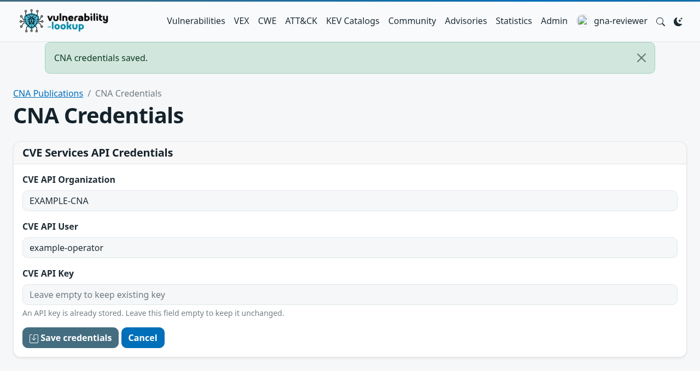
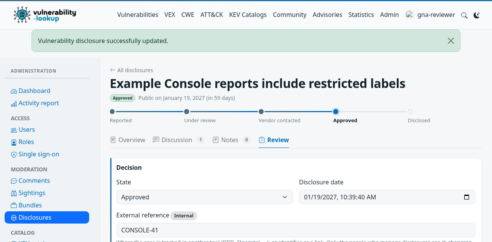
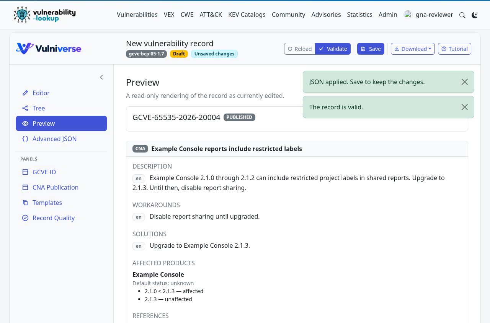
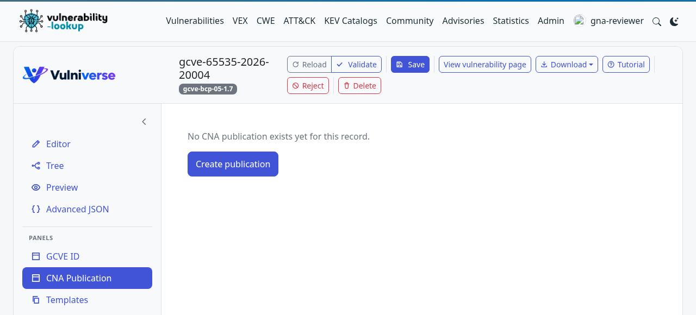
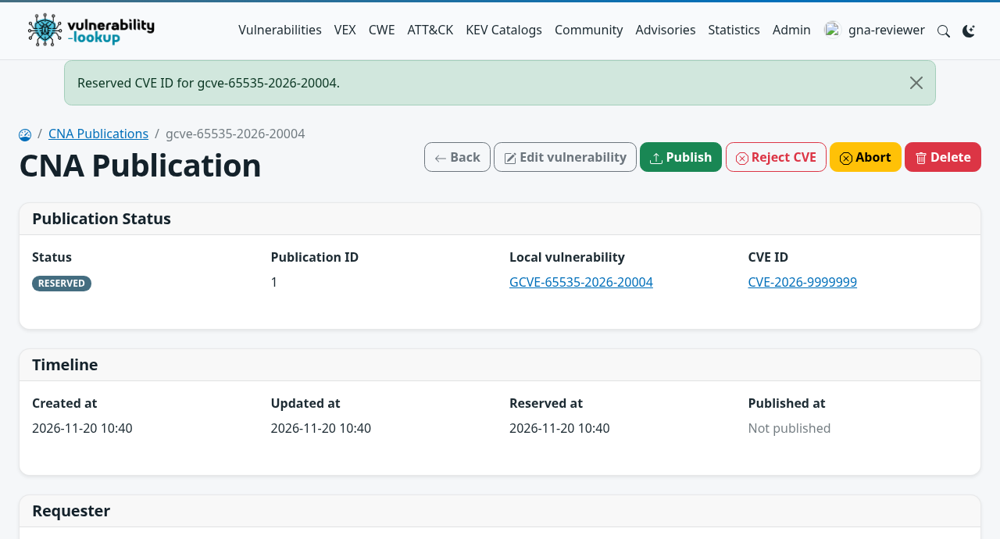
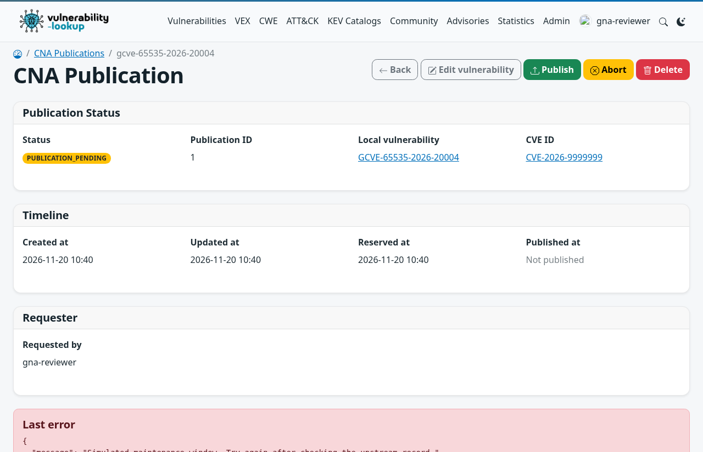
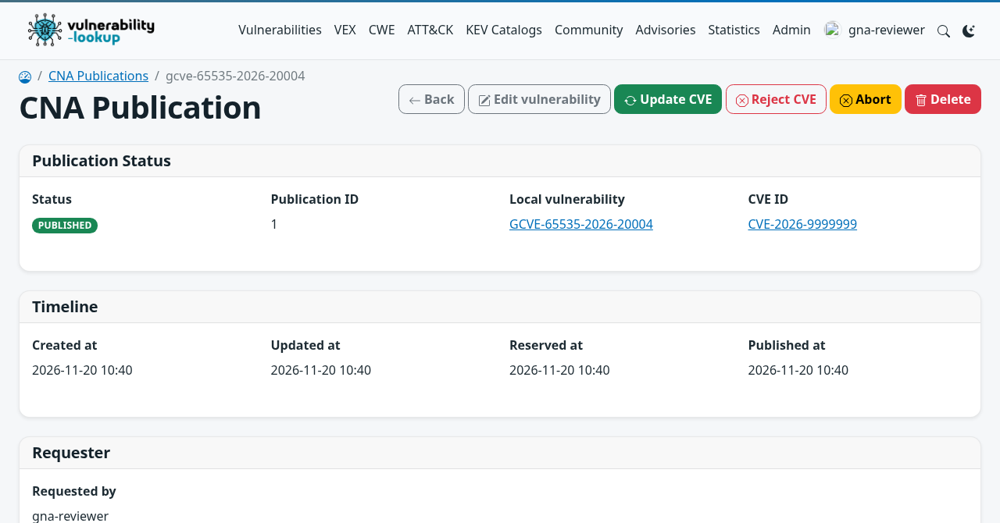
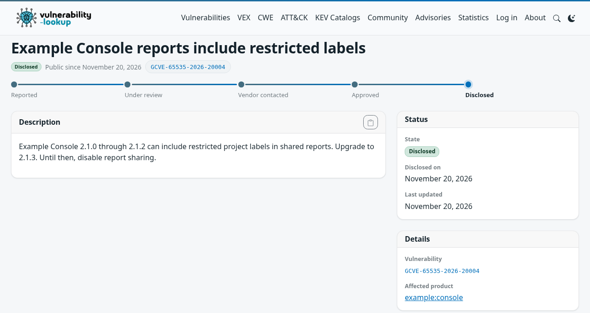
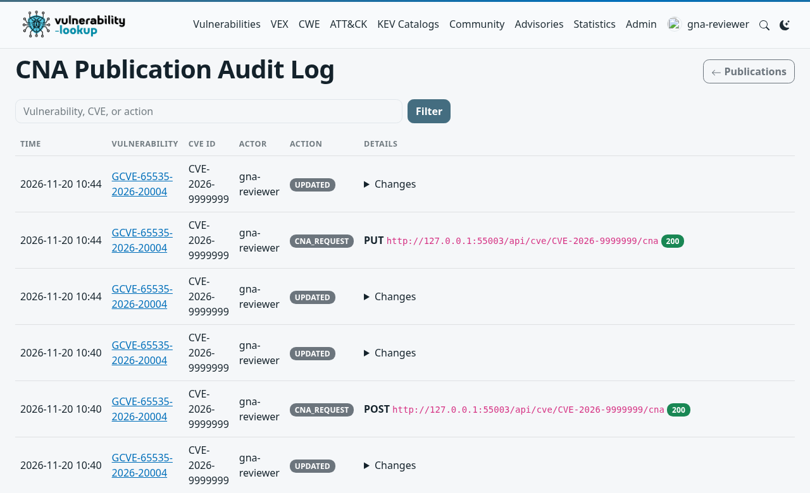

# Publish as a CNA

A CVE Numbering Authority (CNA) assigns CVE IDs within its authorised scope and publishes CVE records through CVE Services. Vulnerability-Lookup keeps the private disclosure case, the local vulnerability record, and the CNA publication workflow in one place. The disclosure case controls who can see the report. The local record supplies the CNA container. The publication workflow tracks reserve, publish, update, and reject requests to CVE Services. [GCVE BCP-02](https://gcve.eu/bcp/gcve-bcp-02/) · [CNA Publication Service](https://www.vulnerability-lookup.org/documentation/cna.html)

The screenshots show the Vulniverse editor in Vulnerability-Lookup 7.1.0 development revision [`b4c82c1`](https://github.com/vulnerability-lookup/vulnerability-lookup/commit/b4c82c13e40a3e2ee91436ff1c52c9bc7021b50d). The walkthrough uses fictional data, a local CVE Services simulator, and [GNA 65535](https://gcve.eu/gna/65535/), the GCVE test namespace. For an authorised service rehearsal, use the CVE Services test environment and credentials issued for it.

## Choose a publication path

Organisations can publish advisories in Vulnerability-Lookup as soon as their instance and advisories are ready. A local identifier such as `EXAMPLE-SA-2026-0001` keeps the advisory addressable while the organisation decides whether it needs authority to assign CVE or GCVE IDs.

| Goal | Path |
| --- | --- |
| Publish advisories under your own identifiers | [Start with local publication](#start-with-local-publication). |
| Assign CVE IDs and publish records through CVE Services within an agreed scope | [Apply to become a CNA](#become-a-cna). |
| Assign GCVE IDs in your own namespace and publish a discoverable feed | [Apply to become a GNA](../gna-publication/index.qmd#become-a-gna). |

We recommend that eligible organisations, including software, hardware and service vendors, apply for both CNA and GNA status. The roles let a team publish through the CVE Program and operate its own GCVE publication source. Eligibility and approval are assessed separately. Choose the identifiers and channels each case needs, and manage both routes from the same Vulnerability-Lookup instance when appropriate. [Coordinate CNA and GNA publication on one instance](#coordinate-cna-and-gna-publication-on-one-instance)

### Start with local publication

1. Enable user accounts and configure `local_instance_name`, a stable `local_instance_uuid`, and `local_instance_vulnid_pattern` in `config/generic.json`. For IDs such as `EXAMPLE-SA-2026-0001`, set `local_instance_vulnid_example` to `EXAMPLE-SA-yyyy-nnnn` and use a matching pattern. Leave `cna` disabled. [Minimal publication instance](https://www.vulnerability-lookup.org/documentation/minimal-publication.html)
2. With an authorised account, use your instance's local API to create the year's range if needed, reserve a local ID, and publish the record at release time. Use `POST /api/cna/cve-id-range/<year>`, `POST /api/cna/cve-id`, and `POST /api/cna/cve/<id>`, respectively. These routes use local authentication and your configured identifier format. See the instance's `/api/` reference for parameters and required permissions. Verify the advisory while signed out. [Vulnerability-Lookup API](https://www.vulnerability-lookup.org/documentation/api.html)
3. Keep the local identifier and advisory URL stable. If you later assign or receive a CVE or GCVE identifier for the issue, add it to the advisory and link the published records. You can also publish locally and work with an existing CNA or GNA when a case calls for an official identifier.

## Become a CNA

1. **Prepare your policy and proposed scope.** The CVE Program asks for a public vulnerability disclosure policy, a public source for new disclosures, and agreement to its Terms of Use. Prepare the policy and advisory URLs, an organisational contact, the products or services you propose to cover, and an estimate of annual CVE ID needs. [CVE Program partner requirements](https://www.cve.org/PartnerInformation/Partner#CNA) · [CVE Program Terms of Use](https://www.cve.org/Legal/TermsOfUse)
2. **Submit the registration form.** In the CVE Program Web Forms portal, choose **Register to Become a CNA**. Use the contact and proposed scope from your preparation and keep the ticket number for follow-up. [How to Become a Partner](https://www.cve.org/PartnerInformation/Partner#HowToBecomeAPartner) · [CVE Program Web Forms](https://cveform.mitre.org/)
3. **Complete onboarding.** Confirm your agreed scope during onboarding, attend the introductory session, and complete the practice CVE exercises. Once the CVE Program lists your organisation as a partner, confirm your registered short name and obtain the appropriate CVE Services access before configuring production publication. [CVE Program onboarding](https://www.cve.org/PartnerInformation/Partner#OnboardingProcess) · [List of Partners](https://www.cve.org/PartnerInformation/ListofPartners)

The CVE Program's 2019 article describes the original registration and training process. Use the current partner page and web forms portal for the application. [Become a CNA to Assign Your Own CVE IDs](https://www.cve.org/Resources/Media/Archives/OldWebsite/blog/August292019_Become_a_CNA_to_Assign_Your_Own_CVE_IDs.html)

## The workflow

{width="80%" fig-alt="Triage the case in private and agree on the release. When local publication is authorised, save the source record, create the CNA publication, and reserve a CVE ID. Send the CNA container to CVE Services. Verify the CVE before marking the case Disclosed. If a request fails, check the upstream state before retrying."}

## Set up the CNA

1. Confirm your authority, scope, and registered CNA short name. Agree who can approve releases, who can submit them, and who handles corrections. For a publication-only deployment, follow the installation guide for PostgreSQL, Valkey, Kvrocks, and the web service. [Minimal CNA/GNA Publication Instance](https://www.vulnerability-lookup.org/documentation/minimal-publication.html)
2. In `config/generic.json`, enable `user_accounts` and set `cna` to `true`. Configure the instance's local source and stable UUID. If the organisation also runs a GNA, configure the local source for its assigned GNA number. [Set up the GNA](../gna-publication/index.qmd#set-up-the-gna)
3. Copy `config/cna.json.sample` to `config/cna.json`. Set `CVE_URL` to the authorised environment's API base URL and `SHORT_NAME` to the CNA's short name. Use `https://cveawg-test.mitre.org/api` for the test service and `https://cveawg.mitre.org/api` for production. Generate a Fernet key for `CNA_CREDENTIAL_ENCRYPTION_KEY` and store it securely. Keep the key available for recovery of the encrypted per-user credentials. [CNA configuration](https://www.vulnerability-lookup.org/documentation/cna.html#configuration)
4. In `config/website.py`, enable `vulnerability_disclosure` and `vulnerability_editor` in `WEB_MODULES`. Set `VULNERABILITY_EDITOR = "vulniverse"` for this walkthrough and keep the `cna-publication` panel enabled in `config/vulniverse.json`. Apply migrations, restart the website, and verify that the disclosure inbox and configured mail delivery work. [Disclosure configuration](https://www.vulnerability-lookup.org/documentation/cvd.html) · [Vulnerability editor](https://www.vulnerability-lookup.org/documentation/editor.html)

### Set up operator access

Each publishing operator opens their account menu and selects **CNA credentials**, then enters their own CVE API organisation, user, and key. On the edit form, leaving **CVE API Key** blank keeps the stored key. Administrators can disable a credential at `/admin/cna-credentials` when an operator leaves or needs their publication access suspended. [Per-user credentials](https://www.vulnerability-lookup.org/documentation/cna.html#per-user-credentials)

{fig-alt="CNA Credentials page showing the fictional organisation and user after saving. The API key field is blank."}

| Task | Access to check |
| --- | --- |
| Report and coordinate disclosures | `vulnerability_disclosure:report` for submission and `vulnerability_disclosure:review` for coordination. Use an administrator account for the admin queue and Review form. |
| Create or edit the local source record | `vulnerability:create` and `vulnerability:modify` on the relevant record. |
| Open or create a CNA publication | `cna_publication:view` and `cna_publication:create`, as appropriate. |
| Submit to CVE Services | The publication UI exposes upstream actions to administrators in this release. Check `cna_publication:reserve`, `cna_publication:publish`, and `cna_publication:reject` for the applicable action and verify that the operator has enabled credentials. |

Test the reporting role separately. The built-in `reporter` role also grants local vulnerability record permissions in this release. Use a dedicated role with the report permission for external submitters. [Roles and permissions](https://www.vulnerability-lookup.org/documentation/rbac.html)

## Receive and coordinate a report

1. Have the reporter sign in and open `/disclosure/new/`. Collect the affected versions, impact, and credit preference. Keep sensitive details in **Confidential details** and check that the main **Description** is suitable for eventual disclosure.
2. In **Admin → Disclosures**, assign a case owner, check scope, and search for existing CVE and GCVE identifiers. Acknowledge the report in **Discussion** and use **Notes** and **External reference** for internal coordination. If a CVE already exists, coordinate with its owning CNA before requesting another ID.
3. Confirm affected and fixed versions, mitigation, release time and time zone, and the publication owner. Record the decision in **Review** and set **State** to **Approved** when ready for the handoff. The case stays private until an operator explicitly sets it to **Disclosed**. [Investigation and coordination](../investigation-and-coordination/index.qmd)

{fig-alt="The Review tab shows Approved and the fictional internal reference CONSOLE-41."}

## Prepare the source record and reserve a CVE ID

1. Prepare the approved public material in a restricted workspace. Under **Advisories → New vulnerability advisory**, prepare the local source record in Vulniverse. Enter the public summary, affected versions, mitigation or fix, advisory links, and agreed credit. Review **Preview** and click **Validate**. Verify the CNA provider metadata and the container required by CVE Services. [Write and evaluate a vulnerability record](../vulnerability-record-quality/index.qmd) · [CVE Record Format](https://github.com/CVEProject/cve-schema)
2. Assign the record its local identifier. The example uses a GCVE ID allocated by the same organisation through the [GNA workflow](../gna-publication/index.qmd#create-the-yearly-range-and-reserve-an-id). In this Vulniverse revision, the **CNA Publication** panel uses the GCVE identifier to find the saved source record. For a deployment using Vulnogram and a separate local identifier pattern, follow the [Vulnogram publication steps](https://www.vulnerability-lookup.org/documentation/cna.html#usage).

{fig-alt="Vulniverse Preview shows the fictional Example Console record, including the affected and fixed versions, and a validation success notice."}

::: {.callout-important}
## Save only when local exposure is authorised

The **CNA Publication** panel requires a saved local record. On a public Vulnerability-Lookup instance, **Save** exposes that record through the local source even while the CVD case is private and the CVE is unpublished. If the case is embargoed, keep the content in the restricted workspace until the release window. When an ID must be obtained earlier, use an authorised reservation process or an access-controlled publication instance, and plan how that reservation will be tracked without obtaining a second ID.
:::

3. Once the local record can be saved, open **CNA Publication → Create publication** and follow **Open full publication page**. You can return to the same publication through **Advisories → CNA Publications**. Its initial state is `LOCAL_ONLY`.
4. On the publication detail page, choose **Reserve CVE ID**. Confirm `RESERVED` and write the returned CVE ID in the case and release plan. The service attempts to mirror the ID into the local record's `cveMetadata.cveId`. If the publication is `RESERVED` but reports a local sync error, reconcile the local record against the existing upstream reservation.

{fig-alt="The Vulniverse CNA Publication panel shows the Create publication button for a saved GCVE record."}

{fig-alt="The CNA Publication page shows RESERVED, the local GCVE identifier, and the fictional CVE-2026-9999999."}

## Publish, verify, and maintain the record

1. At the agreed release time, verify the chosen record, CVE ID, and advisory URL, then click **Publish** on the CNA publication. Treat `PUBLISHED` as acknowledgement of the submission. Check the official CVE record after distribution and compare the public product scope, fix guidance, credit, and references. [CVE Record search](https://www.cve.org/CVERecord)
2. If the operation remains `RESERVATION_PENDING`, `PUBLICATION_PENDING`, or `REJECTION_PENDING`, check the publication's error and audit trail. For ambiguous timeouts, check the outcome in CVE Services before retrying the existing publication. This matters especially for reservations because the upstream service may already have allocated an ID.
3. Publish the user-facing advisory at the agreed time. In **Review**, use **Vulnerability ID** for the case's primary public identifier and add the other verified identifiers to the public advisory when they apply. Check the public text and set the case to **Disclosed**. Verify the case and advisory while signed out. [Advisory and follow-up](../advisory-and-follow-up/index.qmd)

{fig-alt="The local CNA publication shows PUBLICATION_PENDING after the simulated upstream service returned an error."}

{fig-alt="The CNA Publication page shows PUBLISHED and the same fictional reserved CVE identifier."}

{fig-alt="Signed-out disclosure with Disclosed status and the local GCVE record as the case's primary link in the dual-publication example."}

For corrections, edit and save the local record, then use **Update CVE** on the existing publication. Verify both destinations, including the GNA output if it is also published. For an ID that must be withdrawn under CVE policy, use **Reject CVE** with an approved reason and verify the upstream result. **Abort** updates the local workflow only. Use `/publications/audit` on your Vulnerability-Lookup instance to review attempts and handoffs.

{fig-alt="CNA publication audit showing recorded CVE Services requests and state changes for the fictional CVE."}

## Coordinate CNA and GNA publication on one instance

An organisation that operates both a CNA and a GNA can configure one Vulnerability-Lookup instance with its GNA local source and its CNA CVE Services settings. The same private disclosure and saved source record can support a local GCVE publication and a tracked CNA submission. This lets teams prepare scope, remediation, references, and credit once, then manage each ecosystem's release and follow-up in the same instance. Each instance has one configured CNA short name and one local source identity. Use separate instances for separate publishing organisations. [One organisation per instance](https://www.vulnerability-lookup.org/documentation/minimal-publication.html#one-organisation-per-instance)

| Coordinate | What to verify |
| --- | --- |
| Scope and identifiers | Decide which ecosystem outputs are needed. Record one primary identifier in the disclosure case and keep both identifiers in the release plan. Use the common advisory URL in both records. When linking a GCVE record to a CVE, use a GCVE relationship that reflects the scopes. Use `equal` only if they describe the same vulnerability. |
| Release order | Treat saving the local record, reserving the CVE ID, submitting to CVE Services, and disclosing the case as separate actions. A CVE reservation can appear in the GNA feed before the official CVE is published because the service mirrors the ID into the local record. Check both channels independently. |
| Corrections and status | Save the local GCVE correction, submit **Update CVE** for the tracked CVE as applicable, and update the advisory. Verify the GNA publication feed and official CVE record separately. A local save does not resubmit the CVE, and an upstream publication or rejection does not disclose or correct the CVD case. |

[GCVE record relationships](https://gcve.eu/bcp/gcve-bcp-05/#relationships-field) · [GNA release and verification](../gna-publication/index.qmd#verify-and-maintain-your-public-source)
