# Publish as a GNA

A GCVE Numbering Authority (GNA) assigns identifiers in its own namespace and publishes records from its own instance. This chapter follows a report through Vulnerability-Lookup, from private intake to a public GCVE record and advisory. It covers the [GCVE BCP-02 handling lifecycle](https://gcve.eu/bcp/gcve-bcp-02/), with [BCP-04](https://gcve.eu/bcp/gcve-bcp-04/) for identifiers, [BCP-05](https://gcve.eu/bcp/gcve-bcp-05/) for record format, and [BCP-03](https://gcve.eu/bcp/gcve-bcp-03/) for distribution.

The walkthrough uses the Vulniverse editor in Vulnerability-Lookup 7.1.0 development revision [`b4c82c1`](https://github.com/vulnerability-lookup/vulnerability-lookup/commit/b4c82c13e40a3e2ee91436ff1c52c9bc7021b50d). All screenshots show a local instance, fictional report data, and [GNA 65535, the GCVE test namespace](https://gcve.eu/gna/65535/). Use your assigned GNA number for production.

## The workflow

A disclosure case holds the report, discussions, and the team's release decision. An ID reservation allocates a number for that case. The GCVE record describes the issue in a machine-readable format, and the advisory explains what affected users should do. Coordinate their release times and verify each public destination independently.

{width="80%" fig-alt="Triage a private report, approve release, and reserve an ID. Save the public GCVE record at release time, link and disclose the case, then verify the public pages and API."}

## Set up the GNA

1. **Get your GNA number.** Follow the application process and check your entry in the GCVE directory. Use the recommended format `GCVE-<GNA number>-<year>-<serial>` with Vulnerability-Lookup's yearly allocator. Confirm the scope in which your organisation will assign IDs and who can approve releases. [Request a GNA number](https://gcve.eu/publishing-vulnerability-information/) · [GNA directory](https://gcve.eu/gna/)
2. **Choose a deployment.** The [minimal publication guide](https://www.vulnerability-lookup.org/documentation/minimal-publication.html) covers PostgreSQL, Valkey, Kvrocks, and the web service. A publication-only node can leave all feeders disabled. If you need imported sources for correlation, enable the feeds you want on that instance or perform duplicate checks on a separate lookup with those feeds.
3. **Set the instance identity.** In `config/generic.json`, enable `user_accounts`. Set `local_instance_name` to `gna-<your GNA number>` and set `local_instance_vulnid_pattern` and `local_instance_vulnid_example` to match the namespace and serial format. Generate a unique `local_instance_uuid` once and retain it across restores. Set `public_domain` to your externally reachable HTTPS hostname. Review the upper serial limit and priority boundary before creating the year's range.
4. **Enable the operator tools.** In `config/website.py`, turn on `vulnerability_disclosure` and `vulnerability_editor` in `WEB_MODULES` and set `VULNERABILITY_EDITOR = "vulniverse"`. Keep the `gcve-reservation` panel enabled in `config/vulniverse.json`. Set `ADMIN_EMAIL` to the coordination mailbox and `CVD_POLICY_URL` to your public disclosure policy. Apply migrations, restart the service, and verify mail delivery before taking real reports. [Disclosure configuration](https://www.vulnerability-lookup.org/documentation/cvd.html) · [Vulnerability editor](https://www.vulnerability-lookup.org/documentation/editor.html)
5. **Plan verification and recovery.** Ask the GCVE directory maintainers to register your publication base URL in `gcve_pull_api`, then test the endpoint from outside the instance. If you use a local copy of the directory for GNA metadata, refresh it with `poetry run flask --app website.app update_gcve_registry`. Back up the configuration, PostgreSQL case data, and Kvrocks records and allocations together. Rehearse restoring all three before relying on the backups. [GCVE publication transport](https://gcve.eu/bcp/gcve-bcp-03/)

### Grant operator permissions

Use **Admin → Roles** to create roles for the people who perform each action, then assign them to the relevant accounts. Test the roles with separate accounts on staging. The review queue and **Review** form are admin surfaces in this release. Coordinators with `vulnerability_disclosure:review` can open known cases and use **Discussion** and **Notes** without full admin access. [Roles and permissions](https://www.vulnerability-lookup.org/documentation/rbac.html) · [Disclosure roles](https://www.vulnerability-lookup.org/documentation/cvd.html)

| Task | Permission or access |
| --- | --- |
| Submit a report | `vulnerability_disclosure:report`. The case-creation policy assigns owner access to the submitter. |
| Coordinate the case | `vulnerability_disclosure:review`. Use an administrator account for the admin queue and review form. |
| Create the annual range | `vulnerability_id_range:create` |
| Reserve a GCVE ID | `vulnerability_id:reserve` |
| Publish or correct a local record | `vulnerability:create` for publication and `vulnerability:modify` with access to the record for updates. |

For external submitters, use a dedicated role with the report permission. In this release, the built-in `reporter` role also grants local vulnerability record permissions. Check the **Self-Registration Policy** and account confirmation flow before offering public registration.

## Receive and coordinate a report

1. Have the reporter sign in and open `/disclosure/new/`. Ask for the affected product, versions, impact, and a safe summary. Put sensitive details in **Confidential details**. The main **Description** can become public. Ask whether the reporter wants credit and verify the choice at release.
2. In **Admin → Disclosures** (`/admin/disclosures/`), open the new **Reported** case. Assign a case owner, check scope and existing identifiers, and use **Review** to move the case to **Under review**. Acknowledge receipt in **Discussion** and give the reporter a date for the next update.

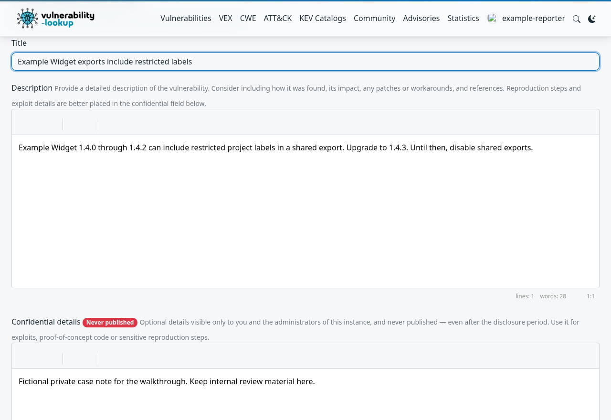{fig-alt="Vulnerability-Lookup intake form with Example Widget in the title field and separate Description and Confidential details editors."}

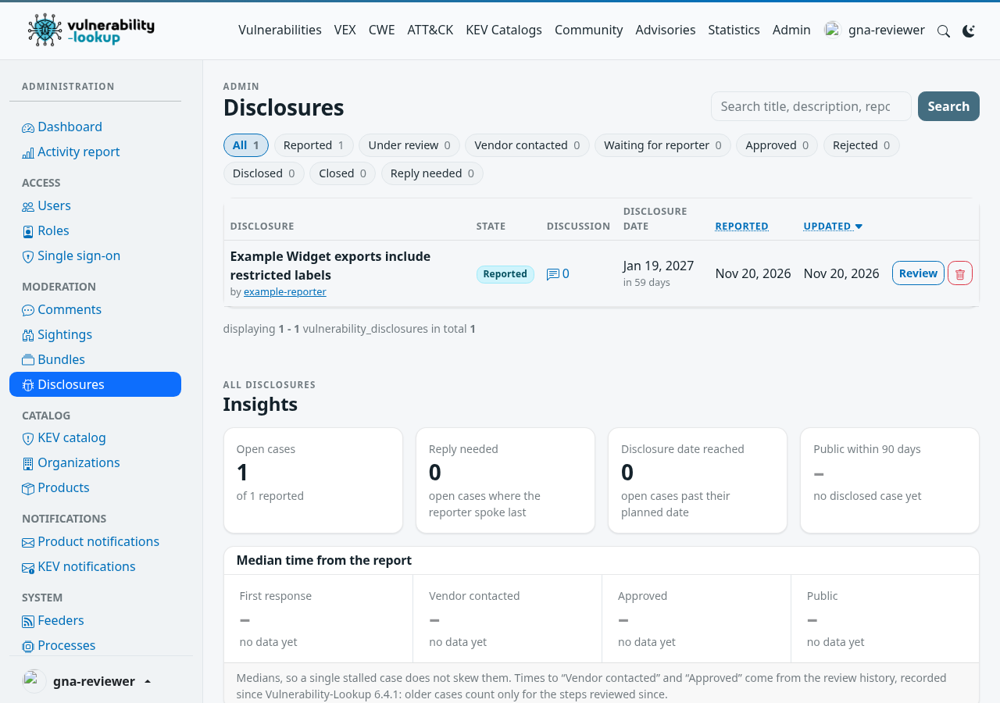{fig-alt="Admin Disclosures queue showing the fictional Example Widget report in the Reported state."}

3. If more information is needed, use **Waiting for reporter**. After contacting the maintainer, use **Vendor contacted**. Keep reporter-facing messages in **Discussion** and private decisions in **Notes**. Use **External reference** on the review form for the restricted coordination ticket.

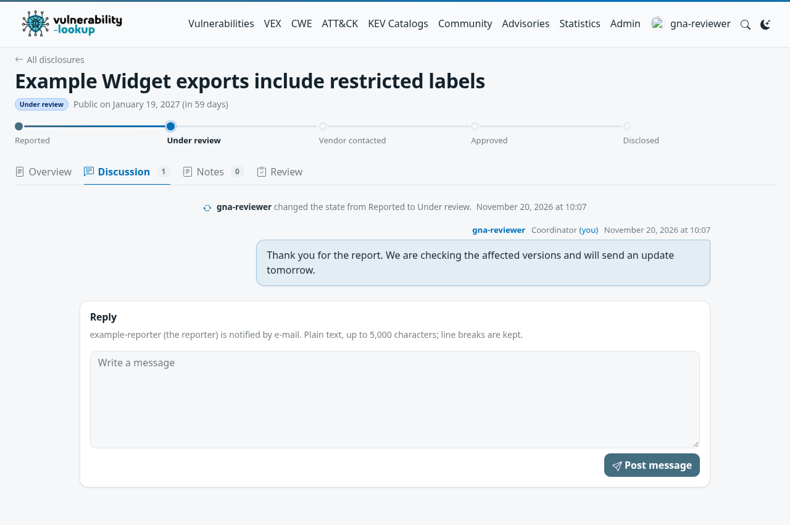{fig-alt="The Discussion tab shows a coordinator acknowledgement and the transition to Under review."}

4. Confirm affected and fixed versions, mitigations, and release timing with the maintainer. Record the release time and time zone in the coordination plan, and set the corresponding **Disclosure date**. Move the case to **Approved** once the release is agreed. That state and date leave the case private until an operator explicitly sets it to **Disclosed**. [Investigation and coordination](../investigation-and-coordination/index.qmd)

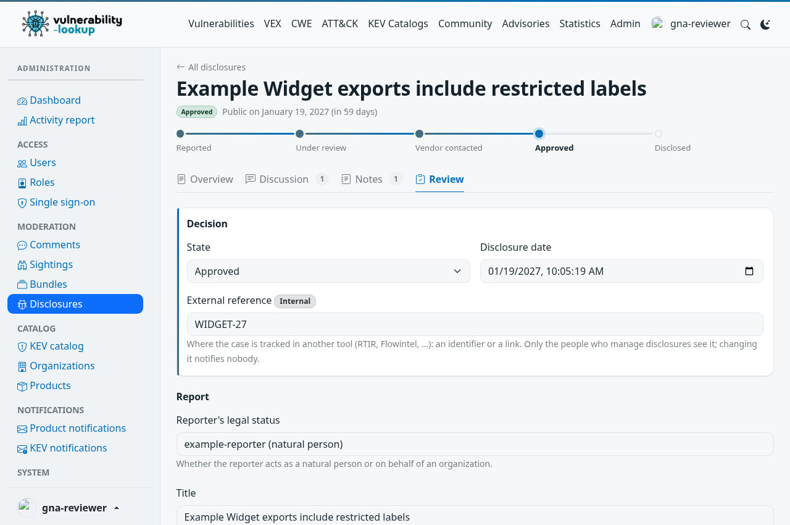{fig-alt="The private Review tab with the case Approved and an example coordination ticket in External reference."}

## Create the yearly range and reserve an ID

1. Under **Advisories → New vulnerability advisory**, open Vulniverse's **GCVE ID** panel. Expand **Create range document**, enter the allocation year, and create the range. Do this once per year before issuing IDs for it. If the range already exists, use it. Preserve the existing allocations when moving or restoring the instance.
2. Expand **Reserve new ID**, enter the year, and request one ID. The editor places the first returned value in **GCVE identifier**. Record it in the private case or coordination ticket and use it in the advisory draft.

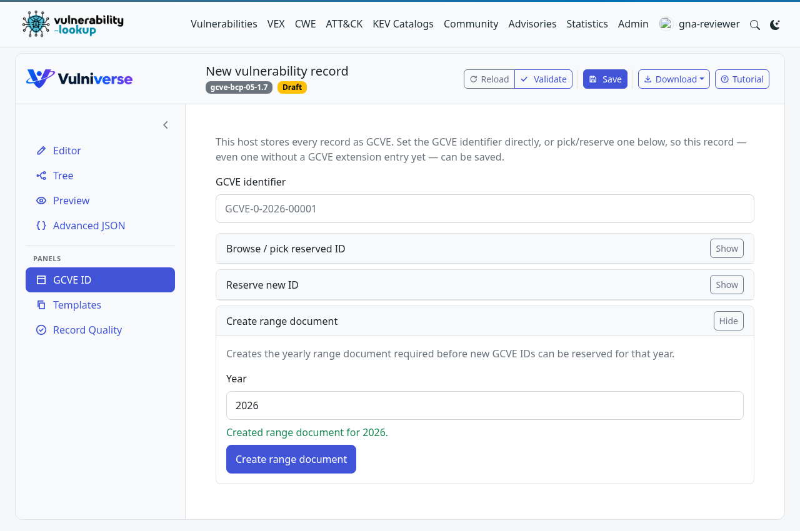{fig-alt="GCVE editor panel with a confirmation that the range document for 2026 was created."}

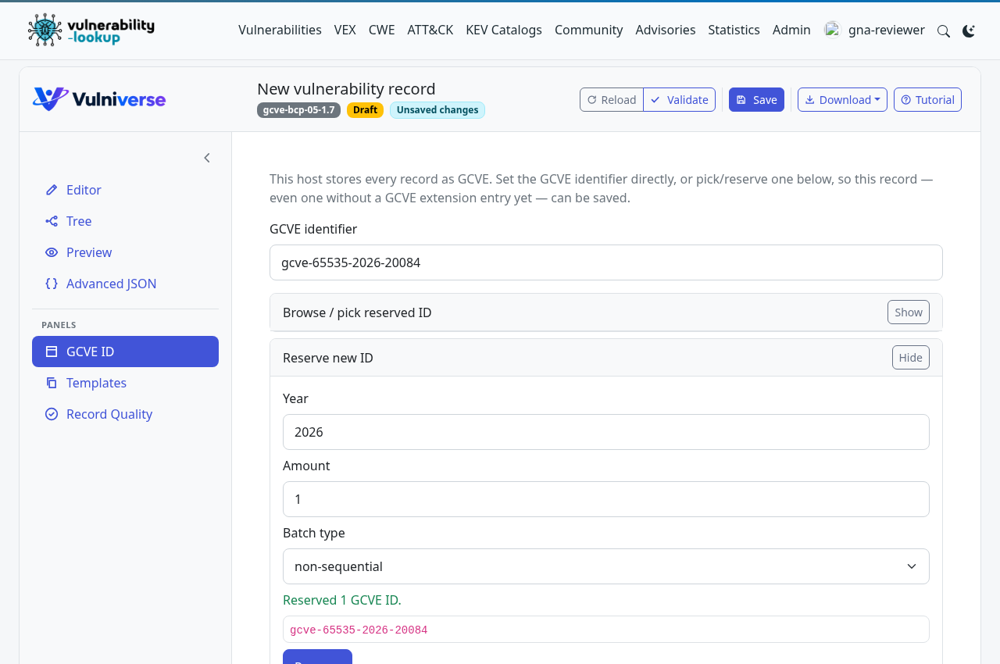{fig-alt="GCVE editor panel showing one reserved ID in the test namespace and the same value in GCVE identifier."}

Use **Browse / pick reserved ID** to reopen an allocation by identifier, year, or state. Choose the case's existing ID when resuming work after a handoff. If a reservation request times out, check the list before retrying so the case keeps one allocation. Keep confirmed identifiers from other sources in the record's cross-references. If scope changes or a case closes without release, document the decision and retain the assignment history. [GCVE ID allocation](https://gcve.eu/bcp/gcve-bcp-04/)

## Prepare, validate, and publish the record

Prepare the text in the restricted workspace while the case is embargoed. In Vulniverse, select the reserved ID, then enter the public title and description in **Summary**, the version ranges in **Affected products**, the fix and mitigations in **Guidance**, and the advisory URL in **References**. Add approved credit under **Credits and timeline** and use the **GCVE extension** for record relationships where applicable. Check **Preview** against the release checklist, then click **Validate** to check the record format. [GCVE vulnerability format](https://gcve.eu/bcp/gcve-bcp-05/)

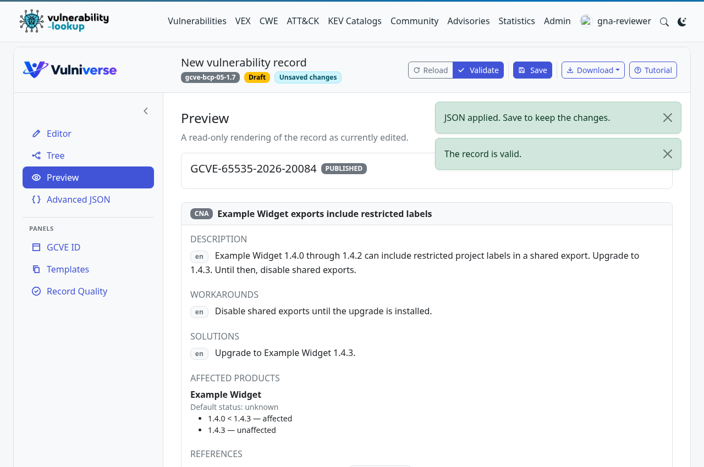{fig-alt="Vulniverse editor showing the Example Widget public advisory and its record validation controls."}

::: {.callout-important}
## Save at the agreed release time

On this Vulnerability-Lookup revision, **Save** publishes a new GCVE record on the local source. The **Draft** badge indicates an unsaved record in the editor. **Preview** can show the proposed record state as **Published** before that save. The disclosure case's **Approved** state controls only the case page. Use the signed-out API to verify whether the record is public.
:::

At release time, save the record and open its public page. Publish the user-facing advisory through the agreed channel and verify the links in both directions. In the case's **Review** form, enter the published GCVE ID under **Vulnerability ID**, verify which report fields will be visible, and set **State** to **Disclosed**. Independently record the time each publication step succeeded. [Advisory and follow-up](../advisory-and-follow-up/index.qmd)

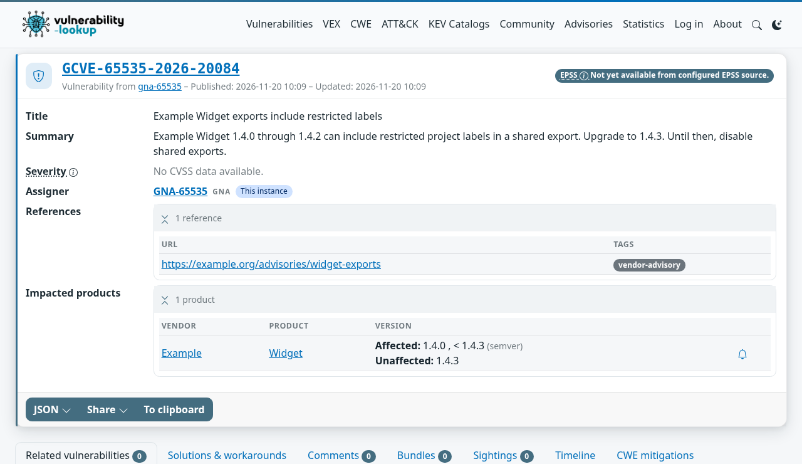{fig-alt="Public Vulnerability-Lookup page for the fictional GCVE with expanded References and Impacted products sections."}

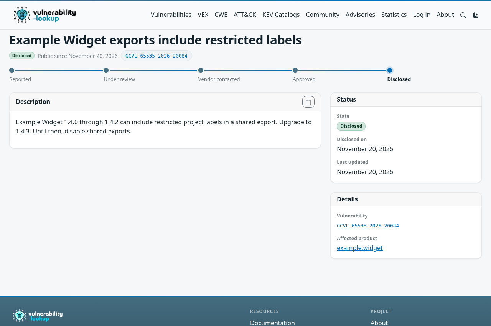{fig-alt="Signed-out disclosure page showing Disclosed status and a link to the same test GCVE identifier."}

## Verify and maintain your public source

- **Check the web views while signed out.** Open the GCVE record, its advisory reference, and the disclosure from `/disclosures/`. Match the ID, dates, affected versions, fix guidance, and credit. Check that confidential details, private notes, and internal references are absent.
- **Check collection over HTTP.** Query `GET /api/gcve/publication` on the published host and confirm the local record and its identifier are present. If you offer a static dump, check that `/dumps/gna-<number>.ndjson` includes the record after export and that the export is refreshed on your publication schedule. Use the [documented publication transport](https://gcve.eu/bcp/gcve-bcp-03/) and the [Vulnerability-Lookup dump commands](https://www.vulnerability-lookup.org/documentation/command-line-interface.html).

  For a recent release, set the instance URL and identifier, then look for a matching entry on the first page of the public JSON feed. Page through the feed or narrow the date window for older records.

  ```sh
  base_url="https://vuln.example.org"
  record_id="GCVE-65535-2026-20084"
  curl -fsS "$base_url/api/gcve/publication?per_page=100" |
    jq -e --arg id "$record_id" '
      .[] | select(any(.containers.cna.x_gcve[]?; .vulnId == $id))
      | .cveMetadata | {state, datePublished, dateUpdated}
    '
  ```

- **Check discoverability.** Compare your directory entry and configured source with the URLs that consumers actually retrieve. If the source already serves the record, investigate the consumer's fetch schedule or filters before taking further publication action.
- **Correct the same record.** Open the published record and select **Edit**. Update it under the same identifier, verify the modified record via the publication API, and update the advisory with a dated correction. Inform the reporter and affected publishers where appropriate. Reopen coordination if the affected scope or available protection changes.
- **Review operations.** Watch for replies needed, disclosures nearing their target date, and inconsistent public records. Verify the remaining annual ID capacity, test backups of case and allocation data, and review delays after release. [CVD insights](https://www.vulnerability-lookup.org/documentation/cvd.html#insights) · [Release checklists](../checklists/index.qmd)

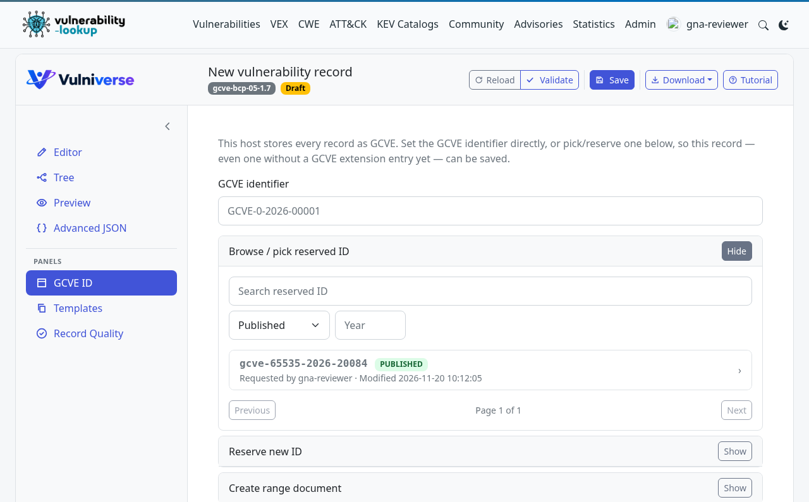{fig-alt="Browse / pick reserved ID filtered to Published, showing the test GCVE record."}
