# Preface {.unnumbered}

This guide shows how to use Vulnerability-Lookup to receive a vulnerability report, coordinate a response, publish an advisory, and keep public information current. It follows the handling lifecycle in [GCVE BCP-02, version 2.0](https://gcve.eu/bcp/gcve-bcp-02/) and links to the product documentation for release-specific configuration and procedures.

## The disclosure lifecycle

{width="92%" fig-alt="BCP-02 stages map to Vulnerability-Lookup activities, from preparation with roles and intake settings through private reports, case review, coordination, publication, and follow-up. A CNA reserves a CVE ID and publishes through CVE Services. A GNA reserves a GCVE ID and publishes through its GNA source. At release, the team links the record and marks the case Disclosed. New evidence returns to triage and lessons inform preparation."}

Keep the reporter and affected parties informed throughout. Maintainers develop, test, and deliver fixes through their engineering and release workflows. Where the Cyber Resilience Act applies, run regulatory reporting in parallel through the Single Reporting Platform. [BCP-02 lifecycle overview](https://gcve.eu/bcp/gcve-bcp-02/#vulnerability-handling-at-a-glance) · [CRA reporting](kev-catalogue/index.qmd#use-exploitation-evidence-in-cra-reporting)

When your team owns identifier assignment, use the agreed CNA or GNA route. Teams can also publish under local identifiers or coordinate with a partner that assigns the identifier. [CNA publication](cna-publication/index.qmd) · [GNA publication](gna-publication/index.qmd) · [Local publication](cna-publication/index.qmd#start-with-local-publication)

## Publication details

**Editor:** 

**ISBN:** 

## Where to start

| If you need to… | Start here |
| --- | --- |
| Set up a coordination team and a test instance | [Roles and handoffs](roles/index.qmd) and [Prepare your instance](preparing-your-instance/index.qmd) |
| Receive and coordinate a report as a CSIRT or maintainer | [Intake and triage](intake-and-triage/index.qmd) and [Investigation and coordination](investigation-and-coordination/index.qmd) |
| Reserve an identifier and publish a record | [Publish as a CNA](cna-publication/index.qmd) or [Publish as a GNA](gna-publication/index.qmd) |
| Release an advisory and verify that readers can find it | [Publish the advisory and follow up](advisory-and-follow-up/index.qmd) |
| Rehearse the handoffs with multiple teams | [Coordinate an upstream and downstream release](multi-party-disclosure/index.qmd) |

A worked Example Portal disclosure starts at [Intake and triage](intake-and-triage/index.qmd). Follow the same case through the reporter and administrator views, coordination, approval, and signed-out release checks.

A case can span three records with different audiences. Keep confidential coordination in the disclosure case. Use the vulnerability record to carry the identifier and approved public data. Give users instructions for protecting their systems in the advisory. The [release checklist](checklists/index.qmd) brings these together.
