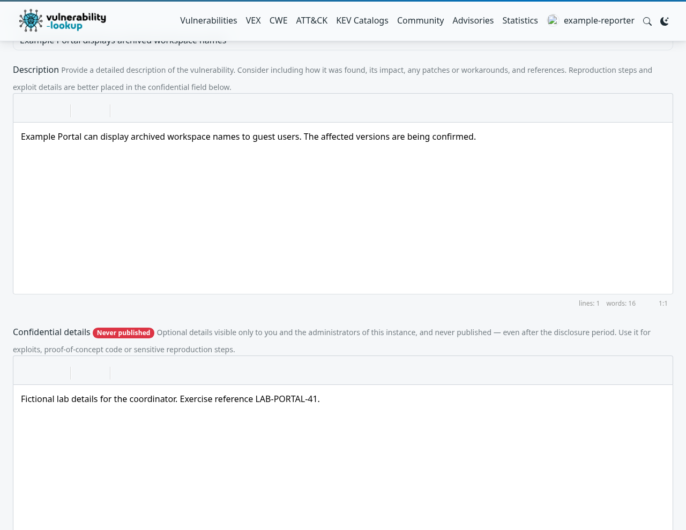
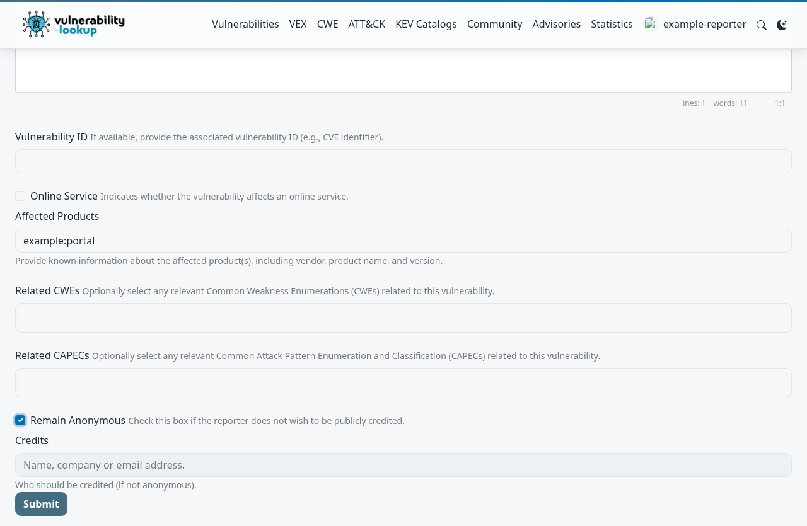
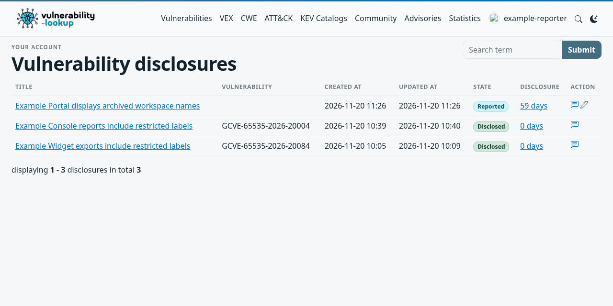
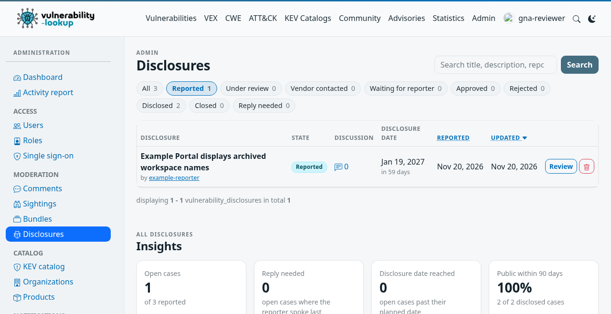
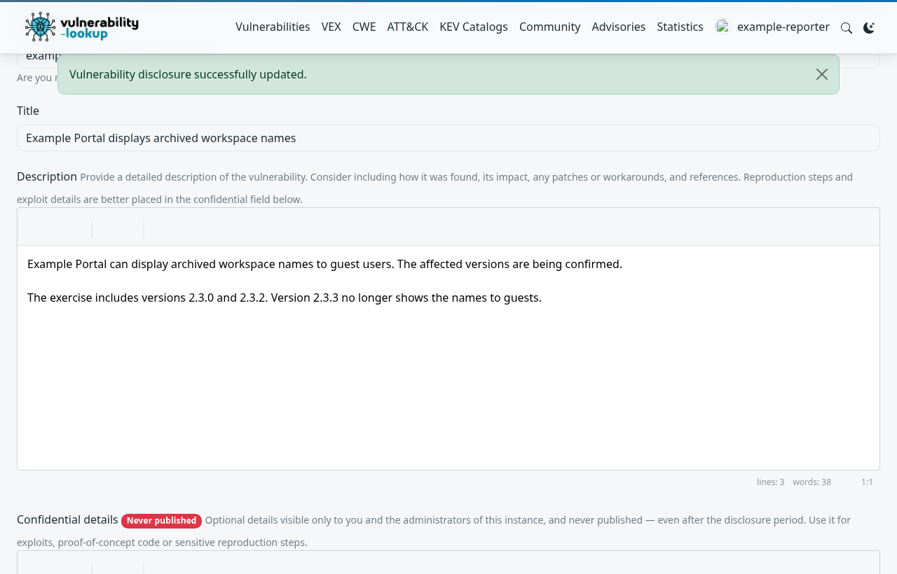
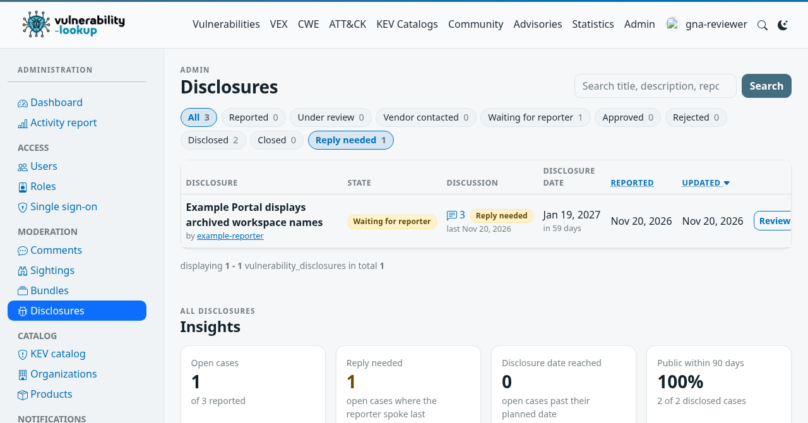

# Intake and triage

This walkthrough follows a fictional report about Example Portal from intake to [public disclosure](../advisory-and-follow-up/index.qmd). The screenshots were taken on a local Vulnerability-Lookup 7.1.0 development instance. [Vulnerability-Lookup revision b4c82c1](https://github.com/vulnerability-lookup/vulnerability-lookup/commit/b4c82c13e40a3e2ee91436ff1c52c9bc7021b50d)

{width="75%" fig-alt="A new report is Reported, then goes Under review. The team can ask the reporter for information and return to review, end the case as Rejected or Closed, or contact the vendor and approve the case. The final Disclosed state follows publication of the vulnerability record and release approval."}

## Submit and follow a report

1. Sign in and open `/disclosure/new/`. Review the disclosure policy and choose whether you are reporting as an individual or on behalf of an organisation.
2. Enter a **Title** and a **Description** with the affected product or service, known impact, and any available mitigation. Draft the description for eventual publication. Keep sensitive material such as private evidence and identifying data in **Confidential details** or in the team's restricted case system.

   {fig-alt="The Example Portal report has a short impact description and a separate Confidential details editor marked Never published."}

3. Select **Online Service** if the issue affects a service, or use **Affected Products** for installed software. Add known CWEs, CAPECs, or a **Vulnerability ID** if available. Record the credit preference or select **Remain Anonymous** for an uncredited report. Select **Submit**.

   {fig-alt="The lower part of the form shows Example Portal in Affected Products and Remain Anonymous selected."}

4. Open **Your disclosures** from the case, or **Vulnerability disclosures** from the account menu. Open the report to check that it is **Reported**, and keep the private case link. **Overview** shows the state and progress. **Discussion** is where you exchange updates with the team. [Reporter workflow](https://www.vulnerability-lookup.org/documentation/cvd.html#for-reporters)

   {fig-alt="The reporter's disclosure list contains the Example Portal report with a Reported badge and its disclosure date."}

## Acknowledge and triage

1. From **Admin → Disclosures** (`/admin/disclosures/`), select **Reported**. Search by title, description, reporter, or external reference when locating a specific case. Open the report and use **Overview** to check the description and any confidential details. The copy buttons on those cards copy the corresponding Markdown source.

   {fig-alt="The Admin Disclosures queue is filtered to Reported and shows the Example Portal case, its reporter, and its disclosure date."}

2. Assign an owner and record the next action in your team's case tracker or a private **Note**. Select **Review**, set **State** to **Under review**, and select **Save review**. In **Discussion**, acknowledge the report and give the reporter a date for their next update. Select **Post message** to send the update through the case.
3. Check that the product is in scope, look for duplicate reports or existing identifiers, and record what you can confirm about impact and versions. Use **Rejected** for a duplicate or out-of-scope report and **Closed** for a case ending without publication. Explain the decision to the reporter in **Discussion**.

## Ask for missing information

Set the case to **Waiting for reporter** in **Review** and describe what you need in **Discussion**. The reporter can use **Edit report** only while the case is **Reported** or **Waiting for reporter**. In other states, they can send corrections in **Discussion**. A saved edit adds a history entry naming the fields that changed and sends a notification to the coordination mailbox.

{fig-alt="The Edit report view confirms that the reporter saved the new information about the tested releases."}

Use the queue's **Reply needed** filter when following up. An open case is flagged when the latest message is from the reporter. State changes and report edits appear in the discussion history alongside messages. When the requested information arrives, review it and move the case back to **Under review**. [Admin queue and review](https://www.vulnerability-lookup.org/documentation/cvd.html#the-admin-table) · [Discussion](https://www.vulnerability-lookup.org/documentation/cvd.html#discussion)

{fig-alt="The Reply needed filter shows the Example Portal case and its latest reporter message indicator."}

**Done when** the reporter has an acknowledgement and the case has a documented triage decision, an owner, and a next action.

**BCP-02** · [Receiving and Handling Vulnerability Reports](https://gcve.eu/bcp/gcve-bcp-02/#receiving-and-handling-vulnerability-reports)
