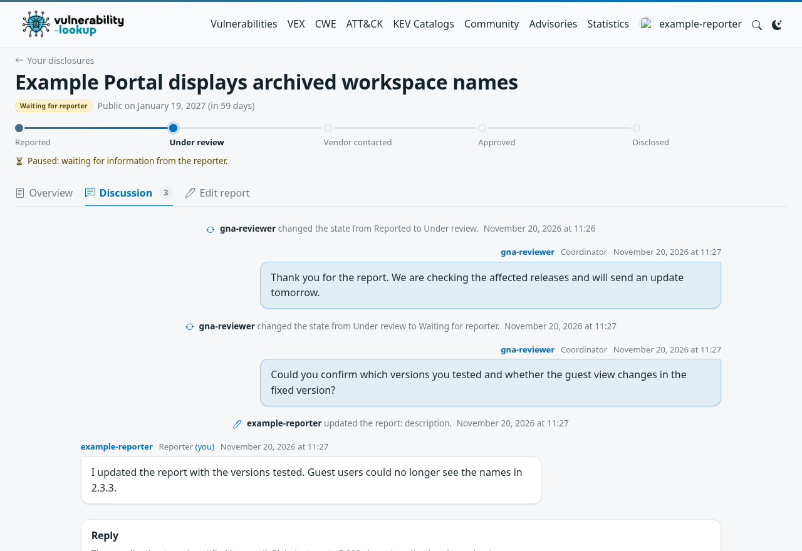
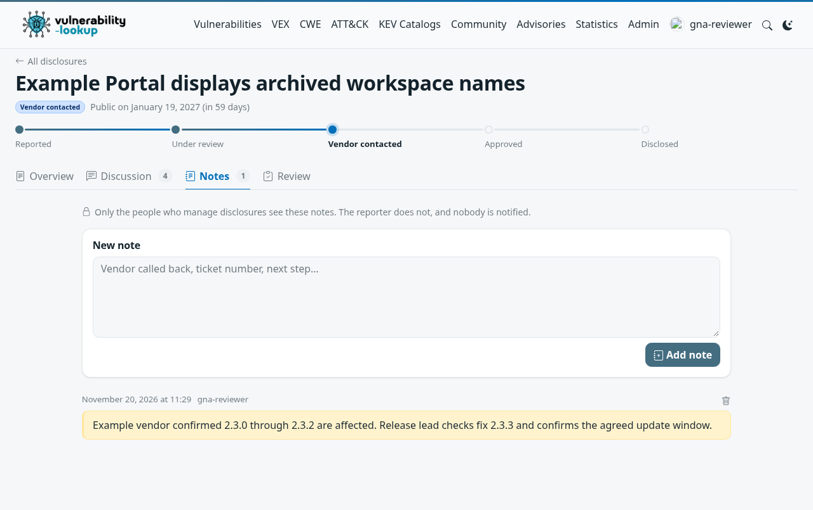
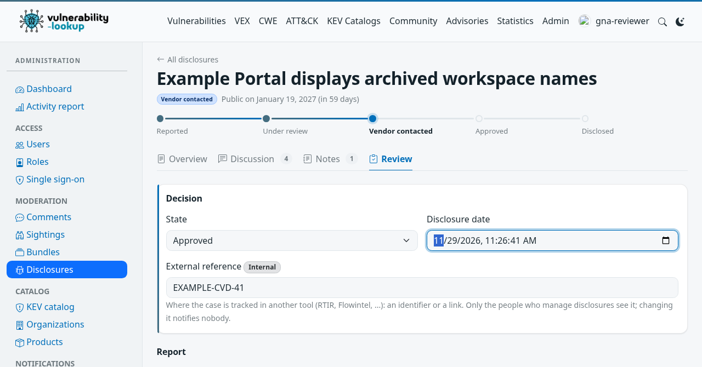
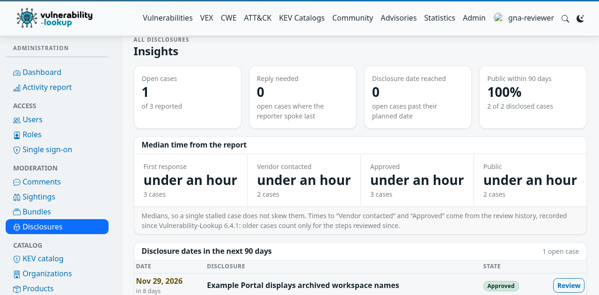

# Investigation and coordination

## Agree on scope and protection

1. Ask the maintainer to confirm affected products and versions, user impact, and available mitigations. Record the vendor contact and move the case to *Vendor contacted* after making contact.
2. Track the fix or mitigation, test status, fixed versions, and update availability. In **Discussion**, use **Post message** to update the reporter. Messages support plain text and are sent by e-mail to the other side. State changes, date changes, and edits appear in the same history.

   {fig-alt="The reporter's Discussion tab shows an acknowledgement, a question from the team, a state change, a report-edit history entry, and the reporter's reply."}

3. Use **Notes → Add note** for vendor calls, internal findings, and the next action. Managers can read the notes and authors can delete their own notes. Notes stay outside the shared discussion and send no e-mail. If the vendor correspondence lives in another system, enter its ticket number or URL as **External reference** in **Review**. That field is visible to managers and in the admin queue.

   {fig-alt="The Example Portal Notes tab shows a private note with confirmed affected versions and responsibility for checking the fixed version."}

4. Agree on a publication time and time zone, the identifier owner, the advisory owner, and the next check-in. Give each participating team a contact for changes in scope or timing. [Discussion and private notes](https://www.vulnerability-lookup.org/documentation/cvd.html#discussion) · [External reference](https://www.vulnerability-lookup.org/documentation/cvd.html#external-reference)

## Decide when to disclose

In **Review**, set **Disclosure date** to the agreed target. The initial value is 60 days after the report was created. Revisit the plan if there is a leak, evidence of exploitation, or a delay in delivering protection. If an early warning is needed, record the reason and the protection users can apply now. Route applicable reporting obligations through your organisation's reporting process in parallel. [CRA reporting](../kev-catalogue/index.qmd#use-exploitation-evidence-in-cra-reporting)

Set **State** to **Approved** and select **Save review** when the case is ready for the release handoff. The case stays private even after its target date passes. Coordinate the explicit transition to **Disclosed** with the advisory and public vulnerability record. [CVD lifecycle](https://www.vulnerability-lookup.org/documentation/cvd.html#lifecycle)

{fig-alt="The administrator's Review form shows Approved, the planned disclosure date, and the example vendor ticket in the internal External reference field."}

Use **Insights** below **Admin → Disclosures** to spot approaching dates, dates already reached, and replies still owed. Review median time to first response and to publication to identify delays in the team's process. The timeline metrics depend on the review history recorded for each case. [Monitor the response queue and release calendar](../monitor-cvd/index.qmd#run-the-daily-queue-review)

{fig-alt="Admin Insights shows open cases, reply and date counters, and a privately visible row for the upcoming Example Portal release."}

**Done when** the release approver has a public draft, confirmed remediation information or an agreed early warning, and a named owner for every release step.

**BCP-02** · [Investigating and Resolving Vulnerabilities](https://gcve.eu/bcp/gcve-bcp-02/#investigating-and-resolving-vulnerabilities), [Communicating with Submitters and Users](https://gcve.eu/bcp/gcve-bcp-02/#communicating-with-submitters-and-users), and [Coordinated Vulnerability Disclosure](https://gcve.eu/bcp/gcve-bcp-02/#coordinated-vulnerability-disclosure)
