# Maintain a local KEV catalogue

Use the local Known Exploited Vulnerabilities (KEV) catalogue to publish what your organisation knows about exploitation. A vendor can attach a finding to its own advisory. A CSIRT can publish a finding about a vulnerability disclosed by another organisation. In either case, your instance publishes a separate assertion with its own status, scope, and evidence. The original advisory continues to describe the vulnerability and its remediation. You can run a catalogue without CNA or GNA status. [GCVE BCP-07 assertion format](https://gcve.eu/bcp/gcve-bcp-07/)

The screenshots use a local Vulnerability-Lookup 7.1.0 development instance. The vendor example follows the fictional Example Widget advisory from the GNA chapter. The CSIRT example uses a real CVE and public CISA evidence to rehearse the process without using a CRA notification. [Publish as a GNA](../gna-publication/index.qmd) · [Vulnerability-Lookup revision b4c82c1](https://github.com/vulnerability-lookup/vulnerability-lookup/commit/b4c82c13e40a3e2ee91436ff1c52c9bc7021b50d)

{width="78%" fig-alt="Match an exploitation report to an advisory. Assess scope and evidence. Where CRA reporting applies, notify securely on the statutory timeline. Once public wording is cleared, save the local KEV assertion, add public evidence and verify the entry and export."}

## Prepare the catalogue and assess the evidence

1. **Set the catalogue identity.** Give the instance a recognisable `local_instance_name` and a unique `local_instance_uuid` in `config/generic.json`. Preserve the UUID across migrations and restores so consumers can recognise the same catalogue. Use an account with `admin:access` for **Admin → KEV catalog**. The record-page shortcut also requires `vulnerability:modify`. [Roles and permissions](https://www.vulnerability-lookup.org/documentation/rbac.html)
2. **Match the public record.** Check the identifier, publisher, affected products, and versions against the evidence. Search the local catalogue by the primary and alternative IDs to find existing entries before creating a new one. Use alternative IDs only for records that identify the same vulnerability.
3. **Agree on what justifies listing.** Decide which observations or credible third-party reports support a positive assertion and who can approve one. Confirm exactly what the evidence shows, such as an attempt or successful exploitation. A CVSS score measures severity. Scanning, a proof of concept, or unverified attempts alone leave successful exploitation unconfirmed. Track unresolved observations in the restricted case until your team can review them.
4. **Approve the public wording and timing.** Prepare a concise source description, scope, and protection guidance. Keep raw telemetry, customer details, confidential reports, and internal case references in your restricted system. Saving the entry publishes its fields on a public instance. Adding evidence on the edit screen also makes that evidence available to readers.

### Record the status and dates

| Field | What to record |
| --- | --- |
| **Vulnerability ID** and **Alternative IDs** | Enter the primary public identifier and any verified equivalents, one per line. |
| **Exploited** and **Status Reason** | For a verified positive assertion, select **Exploited** and **Confirmed**. State what the evidence confirms in the scope or evidence description. |
| **Status Updated At** | Record when the catalogue decision took effect or changed. |
| **First Seen At** and **Last Seen At** | Use supported observation times for exploitation. Clear default values if the observation time is unknown. |
| **Asserted At** | Record when your organisation made the assertion. |
| **Scope Notes** | Describe the limits of the observation, relevant products or versions, and what users can do. Link to the advisory for the full affected range and remediation. |

Review any timestamps prefilled by the form. Keep the observation time, catalogue decision, and the manufacturer's regulatory awareness time distinct. Leave optional characteristics and evidence fields empty when you lack a basis for them. [GCVE BCP-07 status and timestamps](https://gcve.eu/bcp/gcve-bcp-07/)

## List exploitation of your own advisory

In this exercise, a vendor's incident responders confirm exploitation of Example Widget after its advisory is public. The vendor approves a summary of the finding and refers users to the fixed release.

1. Open your published record. Confirm its identifier and affected range, then select **Create KEV Entry**. The form takes the identifier from the record.

   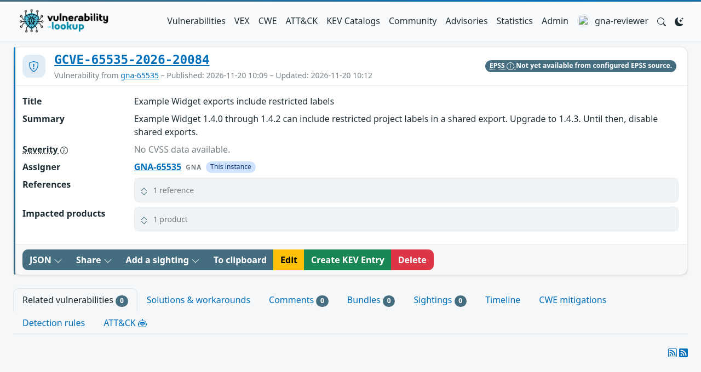{fig-alt="The signed-in Example Widget vulnerability page for the test GCVE with the green Create KEV Entry button."}

2. Verify the prefilled **Vulnerability ID** and add your advisory ID in **Alternative IDs** if it identifies the same issue. Select **Exploited** and **Confirmed**. Check the dates, fill **Scope Notes**, and select **Save** once the assertion is ready to be public.

   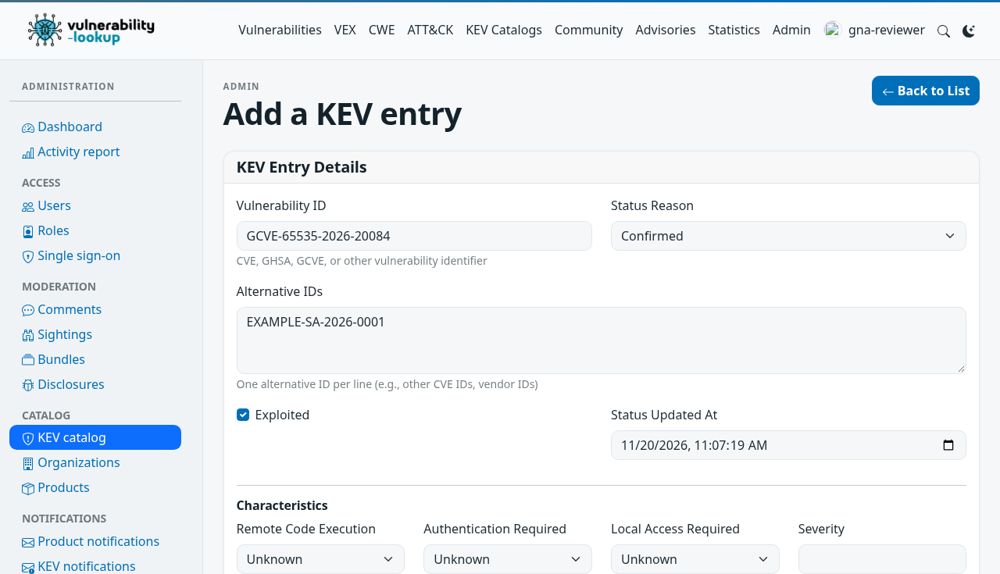{fig-alt="The KEV form has the test GCVE, the vendor advisory alias, Exploited checked and Confirmed selected."}

   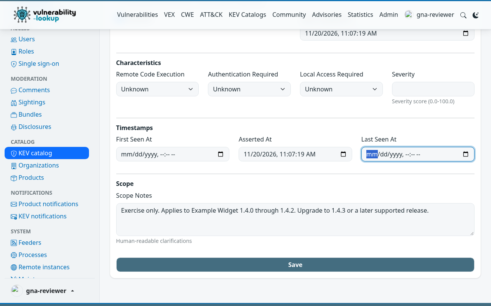{fig-alt="The lower portion of the form with empty first and last seen values, Example Widget scope notes and the Save button."}

3. On the edit page that opens after saving, find **Add Evidence**. Choose **Incident Response** and give the approved public source. For this exercise the **Signal** is **Successful Exploitation**. You can include a brief approved summary in **Details** as JSON. Click **Add Evidence**.

   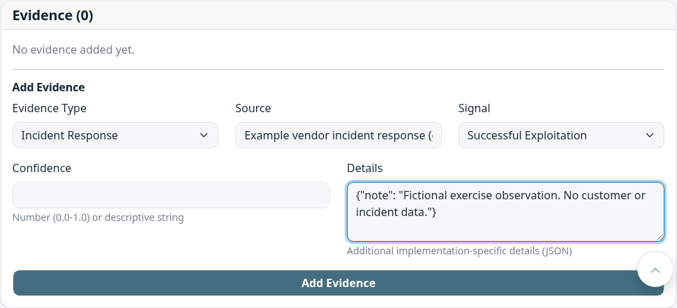{fig-alt="The evidence form shows Incident Response, a fictional vendor response team and Successful Exploitation. The JSON details are a short exercise note."}

4. Open the catalogue entry while signed out. Verify that it shows the correct ID, catalogue, status and scope. Find the evidence and confirm the source and signal agree with the approved summary.

   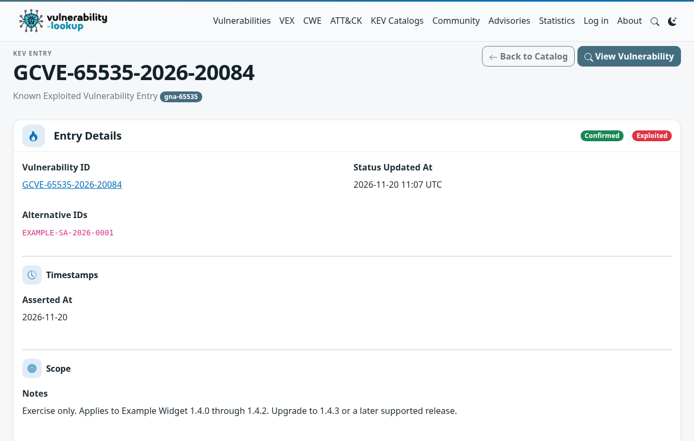{fig-alt="The public page shows the test GCVE, local catalogue badge, Confirmed status, the vendor advisory alias, and exploitation and scope fields."}

   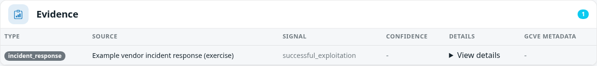{fig-alt="The public Evidence card shows the fictional vendor incident response source, Incident Response type, and Successful Exploitation signal."}

## List exploitation of a third-party advisory

A CSIRT may receive its own incident reports, see activity in telemetry, or receive information through an authorised CRA channel. Confirm which public vulnerability and product the evidence concerns. Check the relevant version or configuration and coordinate with the publisher where needed. A CSIRT can make its own scoped assertion about that vulnerability without editing or republishing the third-party advisory.

This walkthrough uses `CVE-2021-44228` for Apache Log4j2 and relies on CISA's public KEV listing. The CISA listing date, 10 December 2021, is a date of publication in that catalogue. The date of first exploitation is left unset in this example. [CVE record](https://www.cve.org/CVERecord?id=CVE-2021-44228) · [CISA public catalogue data](https://github.com/cisagov/kev-data)

1. Look up the third-party vulnerability and verify the publisher, identifier, and affected product. If your instance collects the relevant vulnerability source, check the imported record and its references.

   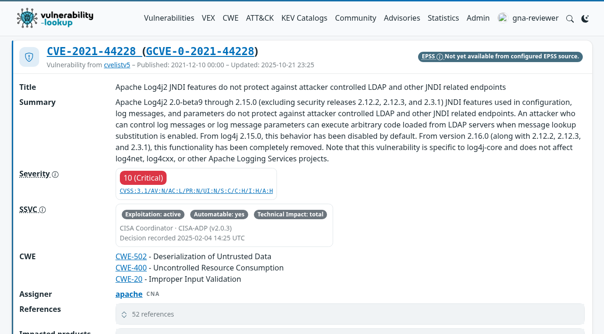{fig-alt="The Vulnerability-Lookup record for CVE-2021-44228 from the CVE List, with its description and Apache publisher information."}

2. Go to **Admin → KEV catalog** and select **Add KEV Entry**. Paste the verified CVE into **Vulnerability ID**. The screenshot adds the equivalent GNA 0 identifier `GCVE-0-2021-44228` on a separate line in **Alternative IDs**. For the public CISA listing, use **Exploited** and **Confirmed**. State the scope and refer users to the upstream guidance, then **Save**. [GNA 0 registry entry](https://gcve.eu/gna/0/)

   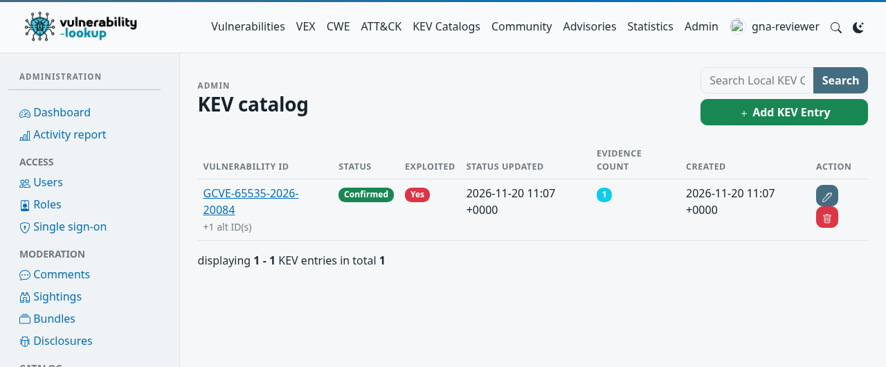{fig-alt="The admin KEV catalog shows the existing vendor exercise assertion and an Add KEV Entry button."}

   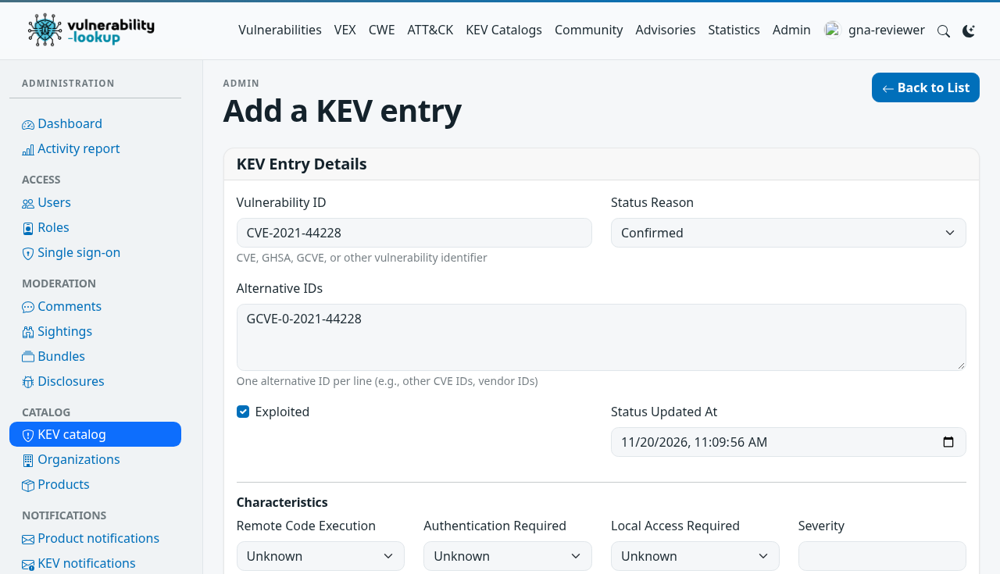{fig-alt="The KEV form shows CVE-2021-44228, its GNA 0 equivalent, and a confirmed exploitation status."}

3. In **Add Evidence**, select **Public Report** and name CISA's catalogue in **Source**. In **Details**, include the public URL and identify the date as the CISA listing date. If a public source gives no finer description of the observed activity, leave **Signal** unspecified. For direct CSIRT findings, choose the appropriate evidence type and publish only the summary and dates cleared for release.

   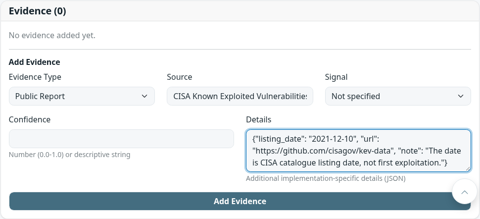{fig-alt="The CSIRT selects Public Report and names the CISA Known Exploited Vulnerabilities Catalog. The details give the listing date and public source URL."}

4. Open the entry while signed out. Follow **View Vulnerability** to check that it still opens the original CVE. Check that the entry is attributed to your catalogue and that CISA is named as the evidence source. Make sure readers can tell which product and versions the evidence covers, especially when a component is bundled in several downstream products.

   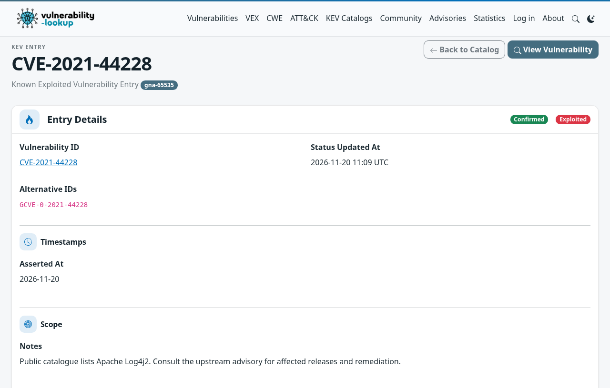{fig-alt="The public KEV detail for CVE-2021-44228 shows the local catalogue, Confirmed status, GNA 0 equivalent and View Vulnerability button."}

   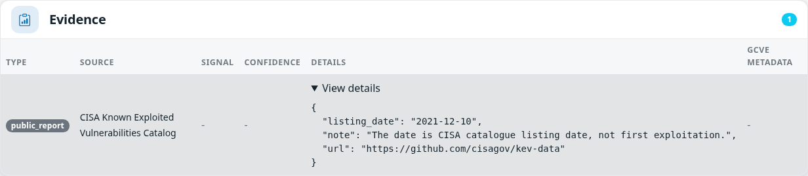{fig-alt="The evidence card names the CISA Known Exploited Vulnerabilities Catalog and expands to show its data URL and listing date of 10 December 2021."}

## Verify and correct assertions

1. **Check the catalogue while signed out.** Open `/known-exploited-vulnerabilities-catalog/` and confirm both entries are present. Follow their detail links and check that each points to the right vulnerability and contains only approved evidence.

   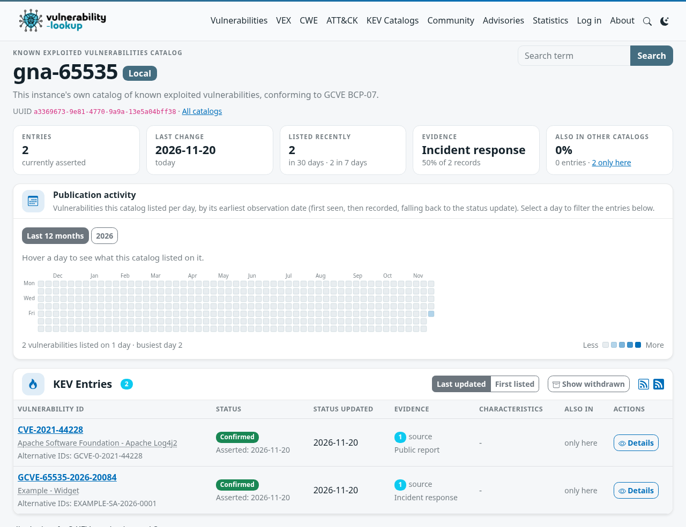{fig-alt="The public local KEV catalogue lists CVE-2021-44228 and the fictional Example Widget GCVE as separate confirmed entries."}

2. **Verify the machine-readable version.** Find the matching `vulnerability.vulnId` in the [BCP-07 export](#share-and-synchronise-bcp-07-assertions). Compare the entry UUID, origin, status, and evidence with the public page. An exploited sighting created from the KEV entry is derived from the same assertion. Count the underlying evidence only once.
3. **Correct the existing entry.** Use **Edit Entry** to update evidence or narrow the scope, record when the decision changed, and inform downstream consumers if their interpretation needs to change. If your organisation retracts its local assertion, open it and choose **Withdraw**. The current list drops the entry and its derived exploited sighting is removed. **Show withdrawn** and the NDJSON export let consumers see the retained entry and evidence under the original UUID. Check that the export now shows `status.exploited` as `false` and `status.status_reason` as `withdrawn`. [BCP-07 withdrawal and reassertion](https://gcve.eu/bcp/gcve-bcp-07/#withdrawn-and-reasserted-kev-assertions)

   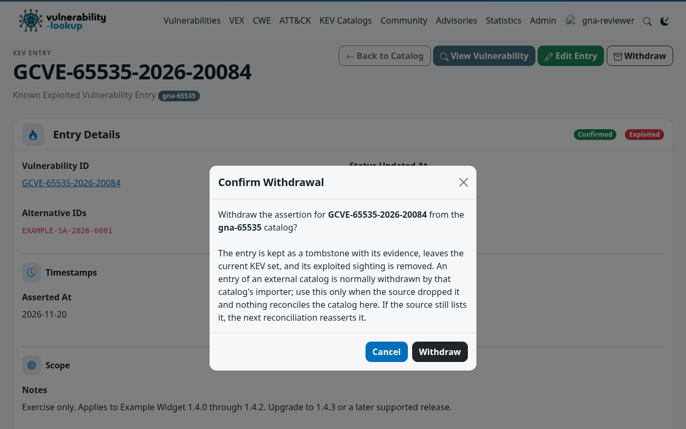{fig-alt="The Confirm Withdrawal dialog identifies the Example Widget GCVE and the local catalogue and explains what happens to the assertion and its evidence."}

   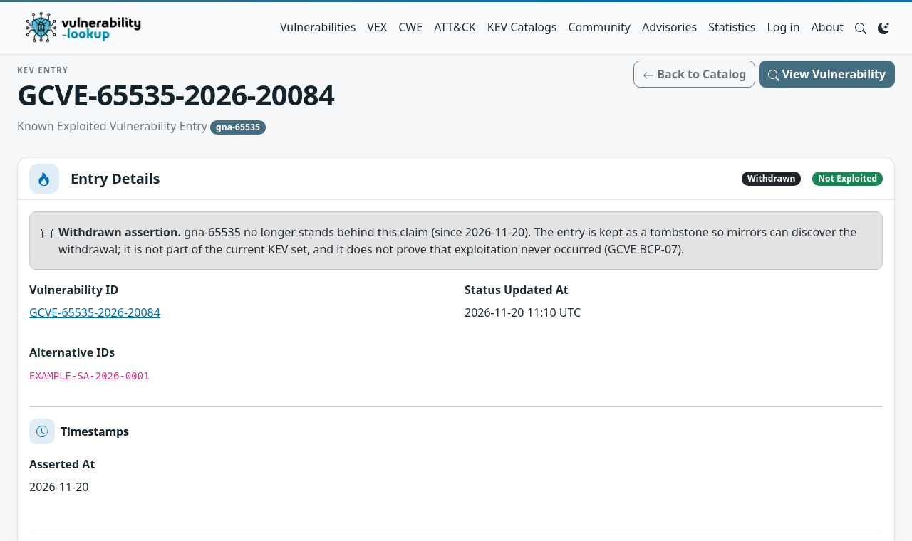{fig-alt="The Example Widget KEV detail displays a Withdrawn assertion notice and shows the exploitation status as withdrawn."}

## Share and synchronise BCP-07 assertions

Vulnerability-Lookup publishes KEV entries in the GCVE BCP-07 assertion format. The catalogue export uses newline-delimited JSON (NDJSON) with one assertion per line. This is the Example Widget assertion from the exercise, pretty-printed with some optional fields omitted. [GCVE BCP-07 KEV assertion schema](https://gcve.eu/bcp/gcve-bcp-07/#json-schema---kev-assertion)

```json
{
  "uuid": "112389b3-5b3e-4288-a2c1-8ebca9beacc1",
  "vulnerability": {
    "vulnId": "GCVE-65535-2026-20084",
    "altId": ["EXAMPLE-SA-2026-0001"]
  },
  "status": {
    "exploited": true,
    "status_reason": "confirmed",
    "status_updated_at": "2026-11-20T11:07:19+00:00"
  },
  "gcve": {
    "origin_uuid": "a3369673-9e81-4770-9a9a-13e5a04bff38",
    "object_uuid": "112389b3-5b3e-4288-a2c1-8ebca9beacc1",
    "gna": 65535
  },
  "evidence": [
    {
      "source": "Example vendor incident response (exercise)",
      "type": "incident_response",
      "signal": "successful_exploitation"
    }
  ]
}
```

The entry's `uuid` identifies the assertion, and `gcve.origin_uuid` identifies the instance that published it. `vulnerability.vulnId` identifies the vulnerability. Several catalogues can publish their own assertions about that same vulnerability and cite different evidence. For a third-party entry, the origin still identifies the catalogue that made the assertion, while `evidence[].source` can credit a source such as CISA. The export can also carry observation times and scope notes.

### Share a catalogue with another instance

1. **On the publishing instance,** share its public HTTPS base URL and the `local_instance_uuid` returned by `/api/system/configInfo`. Give file consumers `/known-exploited-vulnerabilities-catalog/export.ndjson` for the full catalogue, including withdrawn entries. Subscribers can use `/known-exploited-vulnerabilities-catalog/feed.atom` for recent changes. The built-in synchronisation service pulls BCP-07 assertions through the publishing instance's public `/api/kev/` endpoint. [KEV feeds](https://www.vulnerability-lookup.org/documentation/feeds.html#known-exploited-vulnerabilities-kev-feeds) · [Synchronisation service](https://www.vulnerability-lookup.org/documentation/sync.html)
2. **On the receiving instance,** go to **Admin → Remote instances → Add a remote instance**. Enter the publisher's **Instance UUID**, a name, and its base URL in **Address**. Enable **Active** and **Sync KEV Entries**. Keep **Sync local objects only** enabled to pull assertions created by that publisher. Clear the other sync toggles if you only need the KEV catalogue, then select **Save**.

   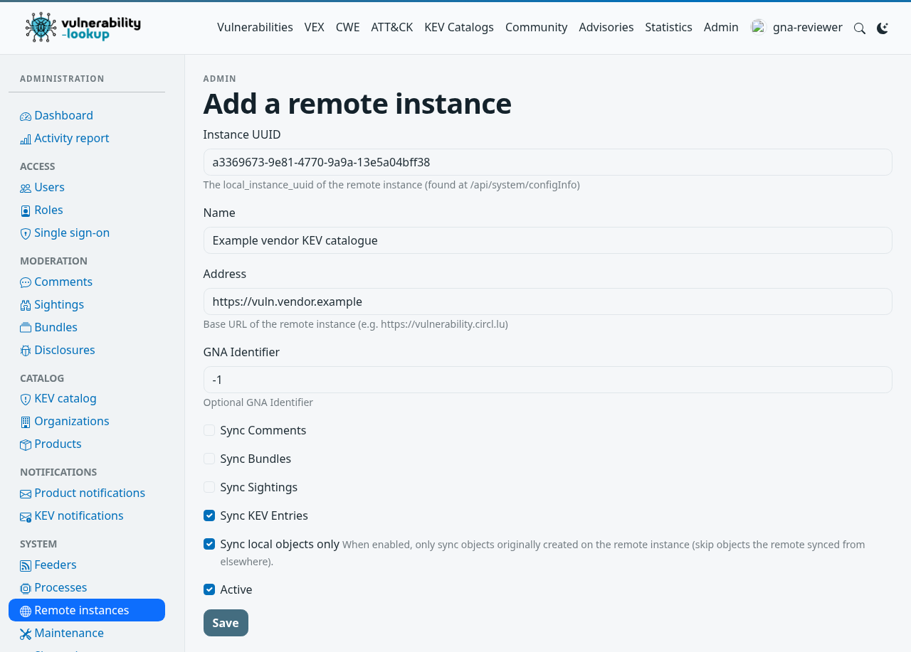{fig-alt="The Add a remote instance form shows the example publisher's address and UUID, with Active, Sync KEV Entries and Sync local objects only selected."}

3. **Run and verify the pull.** In **Admin → Maintenance**, use **Trigger Sync from Remote Instances** with an existing account login. Run the sync service on a schedule to keep the receiving instance current. After a pull, check **Last sync** on the remote instance settings, and inspect the receiver's export at `/known-exploited-vulnerabilities-catalog/export.ndjson?catalog_uuid=<publisher-uuid>`. Replace `<publisher-uuid>` with the publisher's instance UUID. Check that the entry retains the original UUID and origin, with matching status and evidence. [Synchronisation service](https://www.vulnerability-lookup.org/documentation/sync.html)
4. **Verify corrections in the receiving export.** After changing the evidence on a shared entry, save the assertion in **Edit Entry** so the publisher advances its status timestamp. In the version shown, incremental pulls filter by entry creation date. If an older correction or withdrawal is missing, use **Reset last sync** on the receiver's remote instance settings and run the pull again. Verify that a withdrawal updates the existing UUID to `withdrawn` with `exploited` set to `false`.

## Use exploitation evidence in CRA reporting

The EU Cyber Resilience Act (CRA) defines an actively exploited vulnerability by reliable evidence that a malicious actor exploited it in a system without permission of the system owner. For a manufacturer, a KEV entry can help document the exploitation assessment and point users to remediation after public release is cleared. If you learn about exploitation through a third-party component or catalogue, assess whether the affected component and conditions apply to your own product. In the restricted case, record the evidence and its provenance, the affected product and versions, when your organisation became aware, and what protective measures are available. Use that history to prepare and update the notification. [ENISA Single Reporting Platform FAQ](https://www.enisa.europa.eu/topics/product-security/single-reporting-platform-srp/frequently-asked-questions)

For manufacturers in scope, Article 14 reporting for actively exploited vulnerabilities applies from 11 September 2026. Submit the early warning without undue delay and within 24 hours of awareness, and the vulnerability notification without undue delay and within 72 hours of awareness. Submit the final report no later than 14 days after a corrective or mitigating measure becomes available. Use the CRA Single Reporting Platform (SRP) for these reports. Start reporting on the statutory timeline while the public release is being coordinated. [CRA Articles 14 and 16](https://eur-lex.europa.eu/legal-content/EN/TXT/?uri=CELEX:32024R2847) · [ENISA reporting guidance](https://www.enisa.europa.eu/topics/product-security/single-reporting-platform-srp/frequently-asked-questions) · [BCP-02 Appendix A](https://gcve.eu/bcp/gcve-bcp-02/#what-the-cra-adds)

If your CSIRT receives a CRA notification, use the authorised channels for triage and coordination. Verify the product and vulnerability match, record the provenance and applicable restrictions internally, and coordinate any public wording and timing with the responsible parties. When release is cleared, the local catalogue can carry a scoped statement and approved evidence. Keep the notification, report identifiers, detailed observations, and identifying data in the restricted case. [ENISA guidance on notification handling](https://www.enisa.europa.eu/topics/product-security/single-reporting-platform-srp/frequently-asked-questions)
