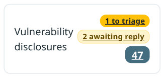
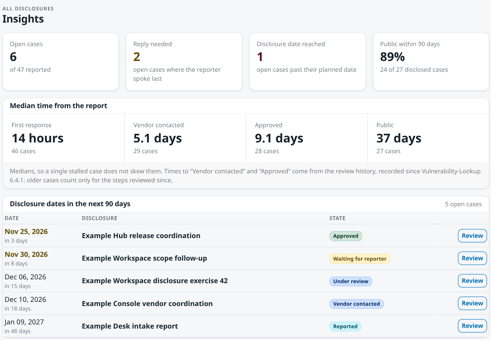
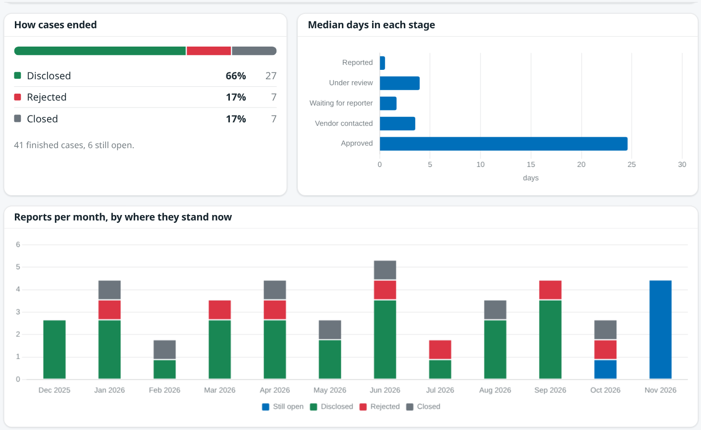
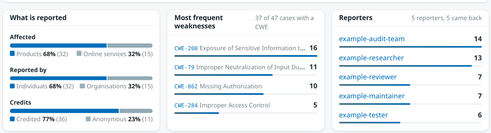
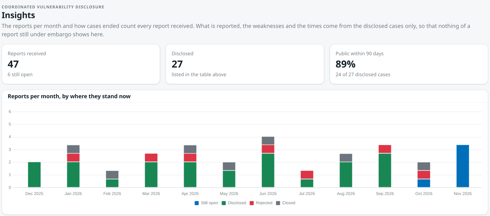
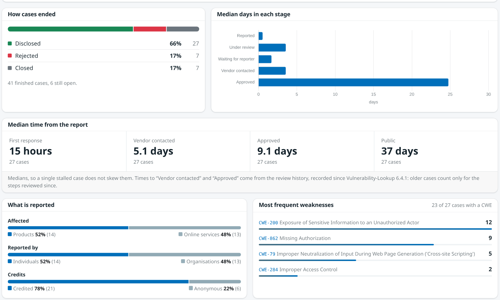
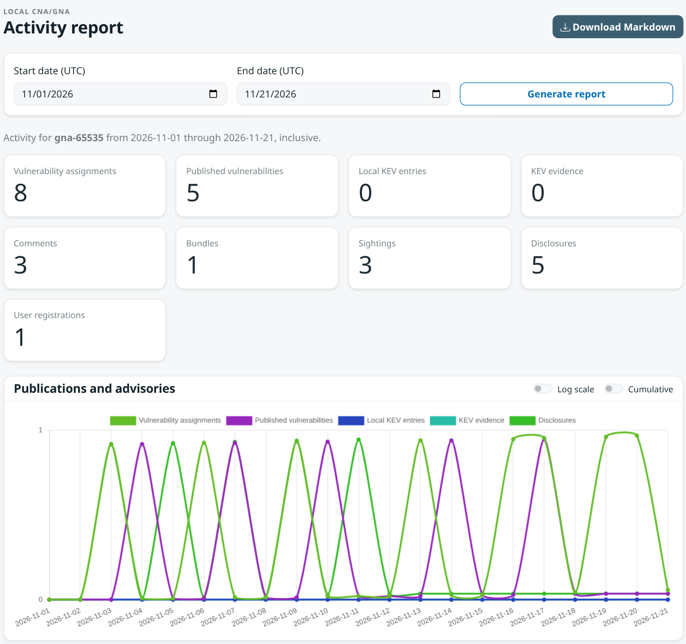
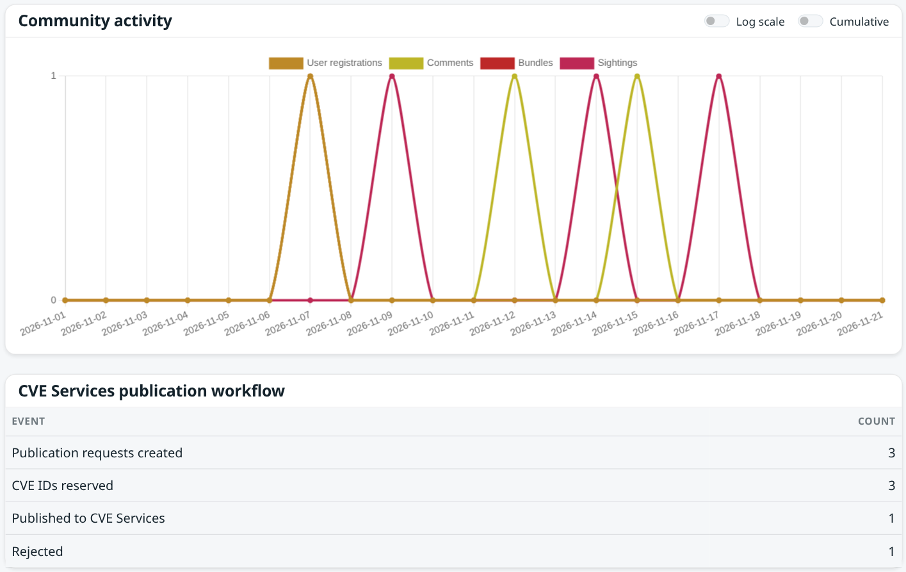

# Monitor CVD activity

Use Vulnerability-Lookup's disclosure statistics to decide which cases need attention today and where the team could improve its process. With an account that has admin access, open **Admin → Disclosures** and scroll below the case table for figures across the instance. The public **Insights** section below the table at `/disclosures/` provides an aggregate view for reporters and other readers. The screenshots use fictional cases in a local Vulnerability-Lookup 7.1.0 development instance. [CVD Insights documentation](https://www.vulnerability-lookup.org/documentation/cvd.html#insights) · [Screenshot revision](https://github.com/vulnerability-lookup/vulnerability-lookup/commit/b4c82c13e40a3e2ee91436ff1c52c9bc7021b50d)

## Run the daily queue review

1. From **Admin → Dashboard**, select **to triage** on the **Vulnerability disclosures** card to open cases still in **Reported**, oldest first. The badge tooltip also gives the age of the oldest case. Assign an owner and acknowledge new reports. The **awaiting reply** badge opens the same list as **Reply needed** in **Admin → Disclosures**.

   {fig-alt="The Vulnerability disclosures dashboard card shows one report to triage, two awaiting reply and a link to all disclosures."}

2. In **Admin → Disclosures**, use the state chips, **Reply needed**, or search to narrow the table. **Reply needed** counts open cases where the latest discussion message came from the reporter. Open **Discussion** to respond. Review rows with no messages as part of intake too. The figures below the table are for **All disclosures**, even while the table is filtered.

3. In **Insights**, review **Open cases**, **Reply needed**, and **Disclosure date reached**. The last count covers open cases at or past their planned time. Check **Disclosure dates in the next 90 days** for upcoming handoffs. Open a row's **Review** action to confirm the fix or mitigation, publication owner, identifier, and coordinated release time. If a date has passed, record what changed and agree the next action with the relevant parties. **Approved** cases stay private until someone explicitly marks them **Disclosed**. [Decide when to disclose](../investigation-and-coordination/index.qmd#decide-when-to-disclose) · [Release checklist](../checklists/index.qmd#at-release)

{fig-alt="Admin Insights shows open cases, replies needed, reached disclosure dates, publication within 90 days, four response and release medians, and upcoming case dates with Review links."}

In the example, **Example Portal overdue review** is waiting for a reply and has passed its planned date. Review it first, then check that the publisher and maintainer are ready for **Example Hub release coordination**, which is approved and due in a few days.

## Check where cases wait

**Median time from the report** uses each case's submission as the starting point. The four checkpoints help distinguish a slow intake from a slow handoff or release.

| Checkpoint | What the card measures | What the team can check |
| --- | --- | --- |
| **First response** | Time to the team's first recorded message or review. | Whether intake has coverage and reporters receive an acknowledgement. A review entry can count without a discussion reply. |
| **Vendor contacted** | Time to the first recorded transition to **Vendor contacted**. | Whether vendor contacts and escalation routes are available when needed. |
| **Approved** | Time to the first recorded transition to **Approved**. | Whether scope confirmation, remediation, and release approval have clear owners. |
| **Public** | Time to the actual disclosure date of cases marked **Disclosed**. | Whether publication handoffs are slowing release after approval. |

**Median days in each stage** charts completed intervals in **Reported**, **Under review**, **Waiting for reporter**, **Vendor contacted**, and **Approved**. When a case returns to a stage, its completed visits to that stage are added together before calculating the median. An ongoing visit has no recorded end. Use the queue for cases still waiting and the chart to see where completed work has tended to wait. The chart's tooltip gives the number of cases behind each bar. The timing cards show their sample sizes and display a dash when there are no qualifying cases. Review history has been recorded since Vulnerability-Lookup 6.4.1, so older or partially tracked cases can contribute to some measures and leave gaps in others.

**Public within 90 days** reports the share of disclosed cases made public within 90 days of intake. Review the numerator and denominator before comparing it across snapshots. To assess whether cases met their own dates or obligations, use the case history and the applicable requirements. The 90-day card applies a common elapsed-time threshold across disclosed cases. [CVD timing and outcome metrics](https://www.vulnerability-lookup.org/documentation/cvd.html#insights)

## Review volume, outcomes, and report mix

- **How cases ended** gives counts and percentages for **Disclosed**, **Rejected**, and **Closed** out of all finished cases, with open cases reported separately. Sample several cases after a change in the mix to see whether intake criteria, duplicate handling, or closure decisions need attention.
- **Reports per month, by where they stand now** groups the last 12 months by the month the report arrived, then stacks each group by its current outcome or open status. Use older intake groups that are still open to find cases worth reviewing and use new volume to plan coverage. A report opened in March and disclosed in May counts in the March group as **Disclosed**.

{fig-alt="The ended-case breakdown, median days per stage and a 12-month stacked chart show outcomes and open cases by report month."}

- **What is reported** splits cases by affected product or online service, individual or organisational reporter, and credited or anonymous preference. Use these splits to check that intake instructions, owner contacts, and credit practices match the kinds of reports the team receives.
- **Most frequent weaknesses** shows up to five CWE IDs and the count of cases that include each one. The card also shows how many cases name any CWE. A case can count against more than one weakness. Review coverage before drawing conclusions, and use repeated categories to prioritise a review with the relevant maintainers. [Writing vulnerability records](../vulnerability-record-quality/index.qmd)
- **Reporters** counts distinct reporter accounts and accounts that submitted more than once. The ranking links to a queue search for each of the displayed repeat reporters. Use it to follow up on recurring issues and improve communication. Keep the ranking internal, including when a reporter chose anonymous public credit.

{fig-alt="Three admin cards show product and service reports, reporter legal status and credit preferences, the leading CWEs and their coverage, and repeat reporter accounts."}

At a regular team review, record the date, the measure, its sample size, and one action with an owner. For example, if time to **Vendor contacted** is rising, review a few stalled handoffs and update vendor contact routes. Use the next review to check whether the change helped. [BCP-02 best practices](https://gcve.eu/bcp/gcve-bcp-02/#best-practices)

## Check what the public can see

Open `/disclosures/` while signed out and scroll past the public case table. **Reports received**, **Disclosed**, the monthly intake chart, and case outcomes show instance-wide counts and states. The publication-within-90-days share, timing and stage charts, report mix, and CWE ranking use **disclosed cases only**. Upcoming dates and open case titles, reply and reached-date indicators, and the reporter ranking stay in the admin view. Public figures are cached for ten minutes, so allow for that interval when checking a new release. [Public Insights documentation](https://github.com/vulnerability-lookup/vulnerability-lookup/blob/b4c82c13e40a3e2ee91436ff1c52c9bc7021b50d/docs/cvd.md#public-insights)

{fig-alt="The signed-out Insights view shows all reports received, disclosed cases, the share disclosed in 90 days, and monthly intake grouped by current outcome."}

{fig-alt="Below the monthly chart are outcomes across finished cases. The stage duration, timing, report mix and frequent weakness cards use only disclosed cases."}

## Export activity for a reporting period

From **Admin → Activity report**, choose inclusive UTC start and end dates and select **Generate report**. **Disclosures** counts reports filed during that period. Use the publication chart and its daily totals to compare that intake with GCVE identifier reservations, published vulnerabilities, local KEV entries, and KEV evidence. The community chart tracks registrations, comments, bundles, and sightings. Each chart supports cumulative and logarithmic views. The separate **CVE Services publication workflow** table shows publication requests created, CVE IDs reserved, publications to CVE Services, and rejections.

Use **Download Markdown** to take the totals, workflow counts, and daily series into a team or management report. Intake, identifier assignment, and publication can occur on different dates and refer to different cases. Use those counts to describe activity during a period and the **Disclosures → Insights** measures to explain case outcomes and elapsed times. [Activity report implementation](https://github.com/vulnerability-lookup/vulnerability-lookup/blob/b4c82c13e40a3e2ee91436ff1c52c9bc7021b50d/website/web/services/activity_report.py)

{fig-alt="The Activity report has UTC start and end dates, a Markdown download button, activity counts including disclosures, and a publication chart with Log scale and Cumulative switches."}

{fig-alt="The community activity chart and its controls sit above the CVE Services workflow counts for requests created, IDs reserved, publications and rejections."}
