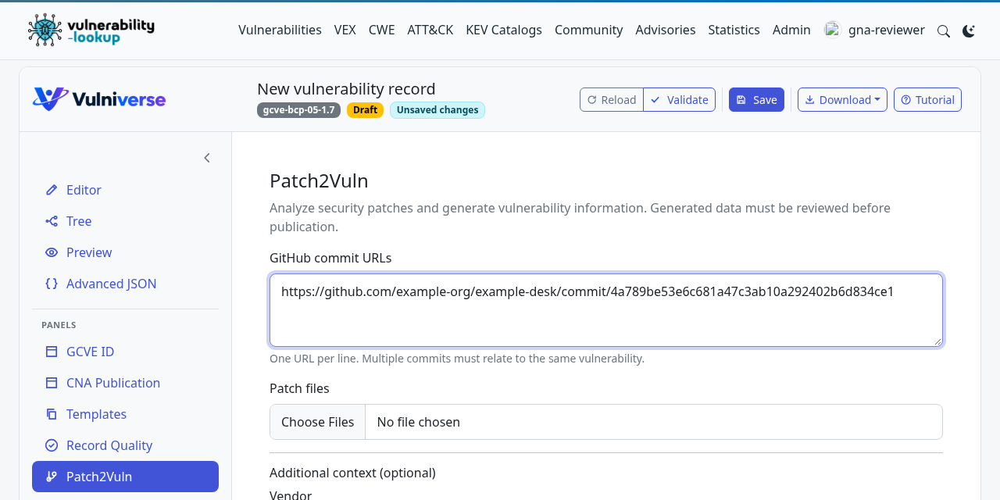
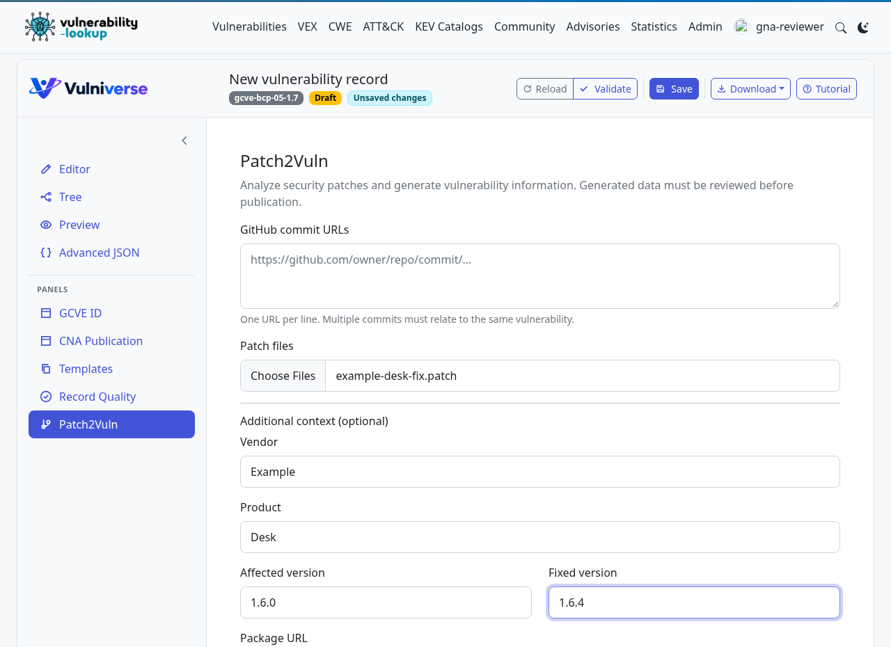
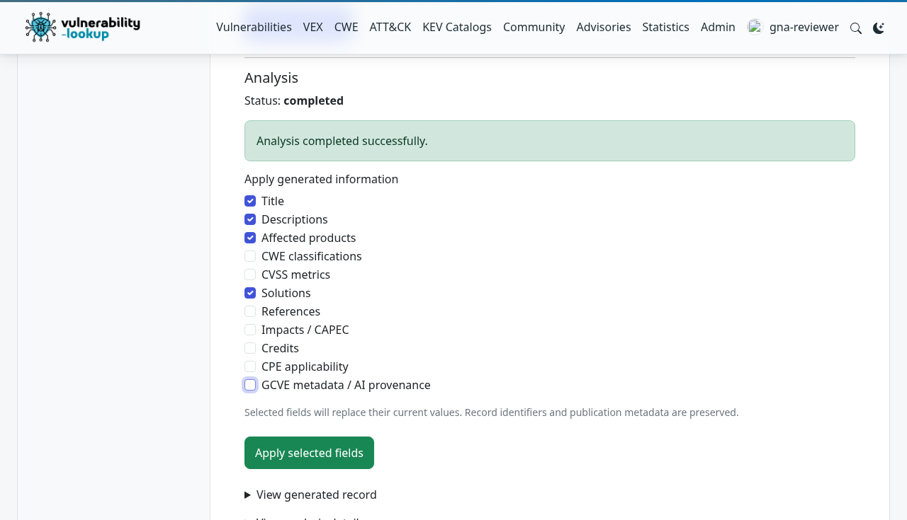
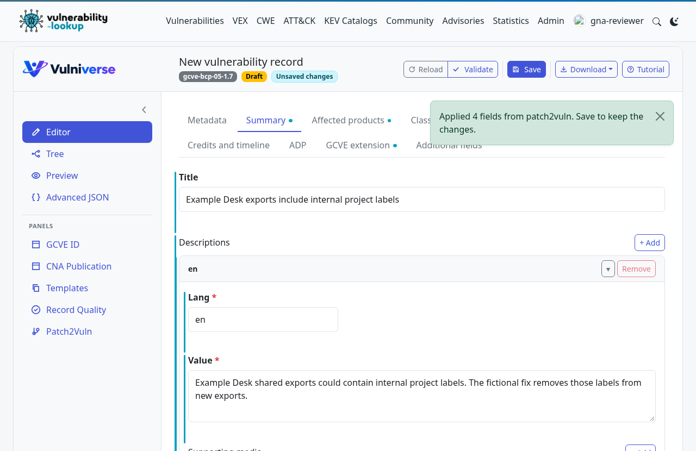
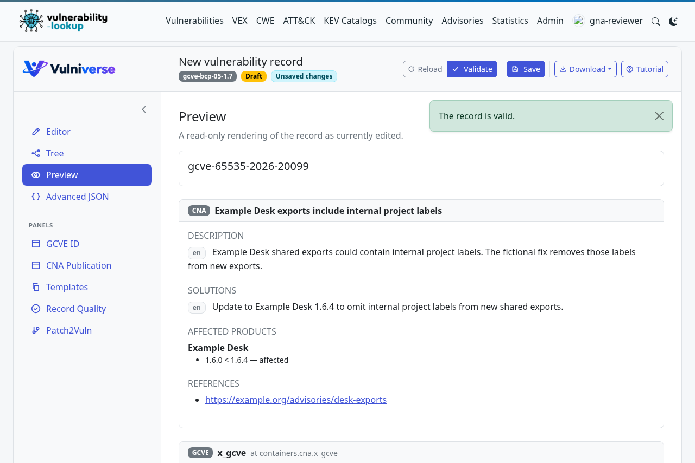

# Draft a security advisory from a patch

When a security fix is available, a vendor or CSIRT can use **Patch2Vuln** in Vulnerability-Lookup's Vulniverse editor to draft a vulnerability record. Use the reviewed record to write the public advisory and give affected users a clear action. A vendor can confirm which releases ship the fix. A coordinating CSIRT can ask the maintainer to confirm scope, remediation, and what can be published. [AI-assisted vulnerability records](https://www.vulnerability-lookup.org/documentation/ai-assisted-records.html) · [Patch2Vuln](https://github.com/gcve-eu/gcve-lab-patch2vuln)

The screenshots show a fictional Example Desk patch in a local Vulnerability-Lookup 7.1.0 development instance. The upload and review run through the Patch2Vuln service with a fixed example model response. The GitHub URL illustrates the input format. [Vulnerability-Lookup revision b4c82c1](https://github.com/vulnerability-lookup/vulnerability-lookup/commit/b4c82c13e40a3e2ee91436ff1c52c9bc7021b50d)

## Prepare the editor and select the fix

In `config/website.py`, enable `vulnerability_editor` in `WEB_MODULES` and set `VULNERABILITY_EDITOR = "vulniverse"`. Run a reachable Patch2Vuln service with a worker and an Ollama model. Enable `patch2vuln_enabled` and set `patch2vuln_url` in `config/patch2vuln.json`, then enable `panels.patch2vuln` in `config/vulniverse.json` and restart the website. The service credential can be set in the server's `PATCH2VULN_API_TOKEN` environment variable. Sign in with a publication operator account that can open the editor. [Configure Patch2Vuln](https://www.vulnerability-lookup.org/documentation/editor.html#configure-patch2vuln) · [Patch2Vuln service and worker](https://github.com/gcve-eu/gcve-lab-patch2vuln/blob/main/docs/web-service.md)

Confirm which commit or patch contains the security fix. Gather the maintainer's affected-release range, fixed releases on supported branches, and any interim mitigation. For an embargoed or internal patch, use a service and model approved to handle that source. The service holds the request while the job is queued or running and retains the result until deletion or expiry. Check its storage and access settings before uploading private material. Keep credentials, unrelated changes, and customer data outside the input. [Patch2Vuln job data and retention](https://github.com/gcve-eu/gcve-lab-patch2vuln/blob/main/docs/web-service.md#asynchronous-jobs)

## Submit a public commit or a patch file

Open **Advisories → New vulnerability advisory** and select **Patch2Vuln**. Choose the input that fits how the fix can be shared.

### Public GitHub commit

Paste the URL of the specific fix commit under **GitHub commit URLs**, one per line. Patch2Vuln fetches the commit patch from GitHub on the server. Use a file upload for a repository hosted elsewhere. Group patches only when they fix the same vulnerability.

{fig-alt="The Vulniverse Patch2Vuln panel shows an example GitHub commit URL and the separate Patch files input."}

### Internal repository or an existing patch file

Export the approved fix commit from a local checkout, or obtain the approved `.patch` or `.diff` from the maintainer. A Git patch may also contain the commit message, author, and internal filenames. Review that material against the scope your vendor or CSIRT is authorised to share.

```sh
git format-patch -1 --stdout "$fix_commit" > approved-fix.patch
```

Set `fix_commit` to the commit that contains the fix. Choose the resulting file in **Patch files**. The file is sent to the configured service, so the service can process it without direct access to the private repository.

{fig-alt="Patch2Vuln shows the fictional example-desk-fix.patch file, vendor Example, product Desk, affected version 1.6.0 and fixed version 1.6.4."}

For either input, fill **Vendor**, **Product**, **Affected version**, and **Fixed version** with facts confirmed by the maintainer. Leave unknown context blank and resolve it during review. Use the correct **Version type** and include an unversioned **Package URL** when known. Select **Analyze patches**. In this release, the panel accepts up to five inputs and 4 MiB of uploaded patches per job. Wait for **Analysis completed successfully** before inspecting the result. [Patch2Vuln inputs and limits](https://www.vulnerability-lookup.org/documentation/ai-assisted-records.html)

## Select, verify, and edit the result

1. Expand **View generated record** and **View analysis details**. Compare the proposed title, description, versions, and solution with the fix and the maintainer's release information. Review any assumptions and resolve differences with the vendor or upstream project.
2. Select the fields you want to use and click **Apply selected fields**. The selected fields replace their current values in the editor. Record identifiers and publication metadata are preserved. In the example, the operator starts with the title, descriptions, affected products, and solution. Keep other fields unchecked until you have independently verified them. [Carry over the AI provenance](#record-ai-assistance-and-patch-provenance)

   {fig-alt="The completed analysis offers a list of fields to apply. Title, Descriptions, Affected products and Solutions are selected."}

3. Review the applied fields in **Editor**. Confirm the impact and affected release ranges, add update instructions and any workaround, and use approved public references. Check that references, credits, comments, and provenance contain only material cleared for release. Confirm severity and any exploitation claims using your team's evidence.

   {fig-alt="Vulniverse shows the imported Example Desk title and description in the Summary panel for analyst review."}

4. Open **Preview** and use **Validate** to check the record format. If enabled, use **Record Quality** to identify missing fields. Have the release approver verify the facts and public wording before publication. Use **Download** to hand off a draft in JSON, HTML, or PDF if the action is enabled. Keep the draft in your restricted case or release system. [Write and evaluate a vulnerability record](../vulnerability-record-quality/index.qmd) · [Vulnerability editor](https://www.vulnerability-lookup.org/documentation/editor.html)

   {fig-alt="The Vulniverse preview presents the reviewed Example Desk description and the publication operator's draft controls."}

## Record AI assistance and patch provenance

By default, Patch2Vuln adds the following GCVE provenance extensions to its generated CVE-format draft. Expand **View generated record** and find them under `containers.cna.x_gcve[].extensions`.

| Extension | What it records |
| --- | --- |
| [BCP-05-X-01](https://gcve.eu/bcp/extension/gcve-bcp-05-x-01/) | The level and scope of AI assistance, the model name or identifier and source, and the human review status. A newly generated draft starts with `ai_level: generated` and `review_status: none`. |
| [BCP-05-X-02](https://gcve.eu/bcp/extension/gcve-bcp-05-x-02/) | How the patch analysis was run and what it produced, including the generator, timestamp, model, patch source and SHA-256, input truncation, confidence, assumptions, and assessment rationales. |

When applying the draft to a CVE or GCVE record, select **GCVE metadata / AI provenance** with the fields you want to carry over, then click **Apply selected fields**. Inspect both extensions in **GCVE extension** or **Advanced JSON**. Keep exact inference settings, such as temperature, in your restricted run log when you need to reproduce the analysis. [Patch2Vuln generation provenance](https://github.com/gcve-eu/gcve-lab-patch2vuln#generation-provenance) · [Vulnerability-Lookup AI-assisted records](https://www.vulnerability-lookup.org/documentation/ai-assisted-records.html#provenance-in-the-record)

Before release, review the extensions for private repository paths, commit subjects, and other details that need clearance. Set `review_status` to reflect the work actually completed. Remove the X-02 `draft` flag once publication review is complete. Check that both extensions remain in the exported record.

The extensions give publishers machine-readable evidence of AI involvement and human review, which can support transparency and documentation under the EU AI Act. Assess the applicable duties for your role and how you publish the advisory. Article 50(4) addresses AI-generated or manipulated text published to inform the public on matters of public interest. It provides an exception where the content has undergone human review or editorial control and a natural or legal person holds editorial responsibility for the publication. Record that responsibility and provide any required disclosure to readers. [EU AI Act Article 50](https://ai-act-service-desk.ec.europa.eu/en/ai-act/article-50)

## Write and release the advisory

Use the approved description and remediation to write a concise advisory for affected users. The Example Desk exercise would tell users that shared exports from versions 1.6.0 through 1.6.3 could include internal project labels and that new exports produced by 1.6.4 omit them. The advisory should tell users where to obtain 1.6.4, what to do about earlier exports if needed, and where future corrections will appear.

Choose the identifier and publication route agreed with the coordinator. Share the reviewed draft with the assigned publisher if another team owns that route. At release, publish the record, link it and the user-facing advisory, then verify both while signed out. If there is an associated Vulnerability-Lookup disclosure, add the public identifier in **Review** and set the case to **Disclosed** at the agreed time. [Local and CNA publication](../cna-publication/index.qmd#start-with-local-publication) · [GNA publication](../gna-publication/index.qmd) · [Advisory and follow-up](../advisory-and-follow-up/index.qmd)
