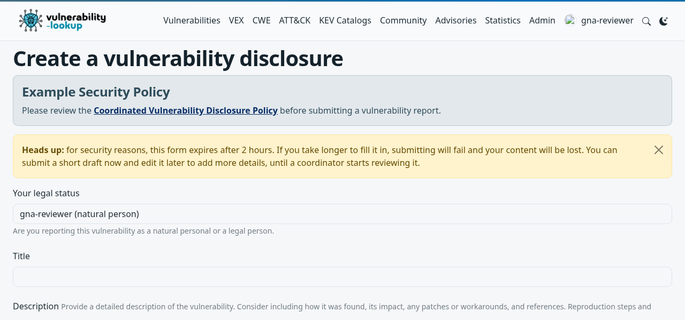

# Prepare your instance

## Configure report intake

1. Publish a disclosure policy with the products in scope, a secure contact channel, and the updates reporters can expect. Assign a team mailbox and a backup owner.
2. On a staging instance, set `user_accounts` to `true` in `config/generic.json`. In `config/website.py`, set `"vulnerability_disclosure": True` inside `WEB_MODULES`, and set `ADMIN_EMAIL` and `ADMIN_NAME` to the coordination mailbox and team name. Add `CVD_POLICY_TITLE` and `CVD_POLICY_URL` to show the policy on the report form. Use `CVD_POLICY_LOGIN_MESSAGE` for sign-in instructions. Apply any pending database migrations and restart the website. [CVD configuration](https://www.vulnerability-lookup.org/documentation/cvd.html#enabling-it)
3. Review the [role assignments](../roles/index.qmd#grant-access-to-the-disclosure-workflow) and your **Self-Registration Policy** before offering public registration. Sign in with a reporter account and open `/disclosure/new/`. Check that it can submit and that the displayed policy is the one you intend reporters to use.

{fig-alt="Vulnerability-Lookup's Create a vulnerability disclosure page displays the Example Security Policy banner."}

### Rehearse notifications and access

Submit a fictional report and use separate reporter, manager, and administrator accounts to check access. Confirm time-sensitive notifications arrive at the mailbox that is responsible for the next action. [CVD e-mail events](https://www.vulnerability-lookup.org/documentation/cvd.html#e-mails-at-a-glance)

| Action | Expected recipient |
| --- | --- |
| Reporter submits a new report, edits it, or posts a message | Coordination mailbox (`ADMIN_EMAIL`) |
| Team posts a message | Reporter |
| Administrator changes the state or disclosure date | Reporter, in one review message per save |
| Manager adds a private note or an administrator changes only the external reference | No e-mail |

Check that an unrelated account cannot read the case. If you assign a manager to a single disclosure, use a second private case to [verify the assignment's scope](../roles/index.qmd#assign-a-manager-to-one-disclosure). Repeat the public check while signed out at **Approved**. A complete rehearsal then publishes the example and verifies which fields are visible. [Intake and triage](../intake-and-triage/index.qmd) · [Verify as a reader](../advisory-and-follow-up/index.qmd#verify-as-a-reader)

## Choose a publication route

Use a [minimal publication deployment](https://www.vulnerability-lookup.org/documentation/minimal-publication.html) when the instance's main job is to publish records. Set up [CNA publication](../cna-publication/index.qmd) for CVE Services or [GNA publication](../gna-publication/index.qmd) for the allocated GCVE namespace. If another organization assigns the identifier, agree in advance who will reserve it, publish the record, and communicate any corrections.

**BCP-02** · [Preparing for Vulnerability Handling](https://gcve.eu/bcp/gcve-bcp-02/#preparing-for-vulnerability-handling)
