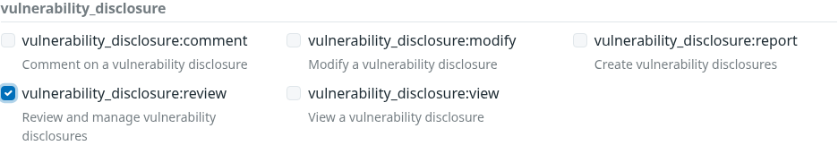

# Roles and handoffs

Assign a case owner, a backup, and a release approver before reports arrive. One team can hold several roles. Record who owns the next action when responsibility passes between teams.

| Role | Responsibility | Handoff |
| --- | --- | --- |
| Reporter | Describe the issue, clarify affected scope, and state credit preferences. | Submit through the private reporting channel and keep the case reference. |
| CSIRT or other coordinator | Own intake, triage, reporter communication, and coordination across affected parties. | Send each maintainer the information needed to assess its products and agree on the next update. |
| Maintainer or product security team | Confirm affected releases, prepare and verify mitigations or fixes, and plan delivery. | Supply affected and fixed versions, remediation instructions, and a release decision. |
| CVE Numbering Authority (CNA) | Assign and publish CVE records within its authorized scope. | Return the CVE ID and verify the published CVE record. |
| GCVE Numbering Authority (GNA) | Assign identifiers within its GNA namespace and publish GCVE records. | Return the GCVE ID and verify the public record and its distribution. |
| Publisher | Review and release the user-facing advisory, then maintain corrections. | Give the coordinator the public advisory URL and confirmation of release. |

## Grant access to the disclosure workflow

| Account | Access in Vulnerability-Lookup |
| --- | --- |
| Reporter | Needs `vulnerability_disclosure:report` to submit. The creation policy grants the reporter the scoped `vulnerability_disclosure_owner` role on the new case, allowing them to view it, join its discussion, and edit the report in the states that allow edits. |
| Disclosure manager | A global role with `vulnerability_disclosure:review` allows the manager to open a known case, join its discussion, and read private notes and the external reference. Share the private case link with the assigned manager. |
| Administrator | `admin:access` gives access to **Admin → Disclosures** and the **Review** form that sets state and disclosure date. The built-in admin role also has the disclosure management permissions. |

In **Admin → Roles**, create a globally assignable role with `vulnerability_disclosure:review` if a manager only needs case access. Assign that role to the manager and test the case link with their account. Arrange for an administrator to review the queue and make state changes. Identifier reservation and release use the permissions for the chosen publication route. [CVD roles](https://www.vulnerability-lookup.org/documentation/cvd.html#who-does-what) · [Role-based access control](https://www.vulnerability-lookup.org/documentation/rbac.html)

{fig-alt="The Vulnerability-Lookup role editor lists disclosure permissions, with vulnerability_disclosure:review selected."}

**BCP-02** · [Roles and Responsibilities](https://gcve.eu/bcp/gcve-bcp-02/#roles-and-responsibilities)
