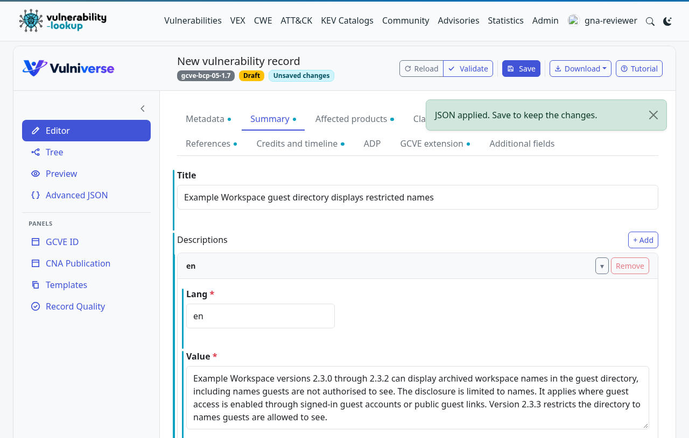
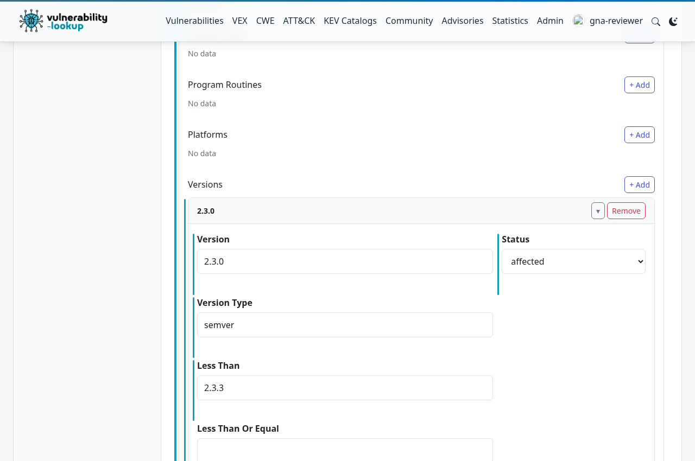
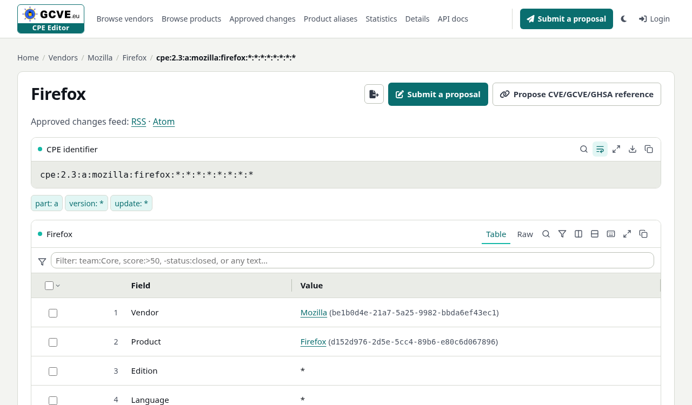
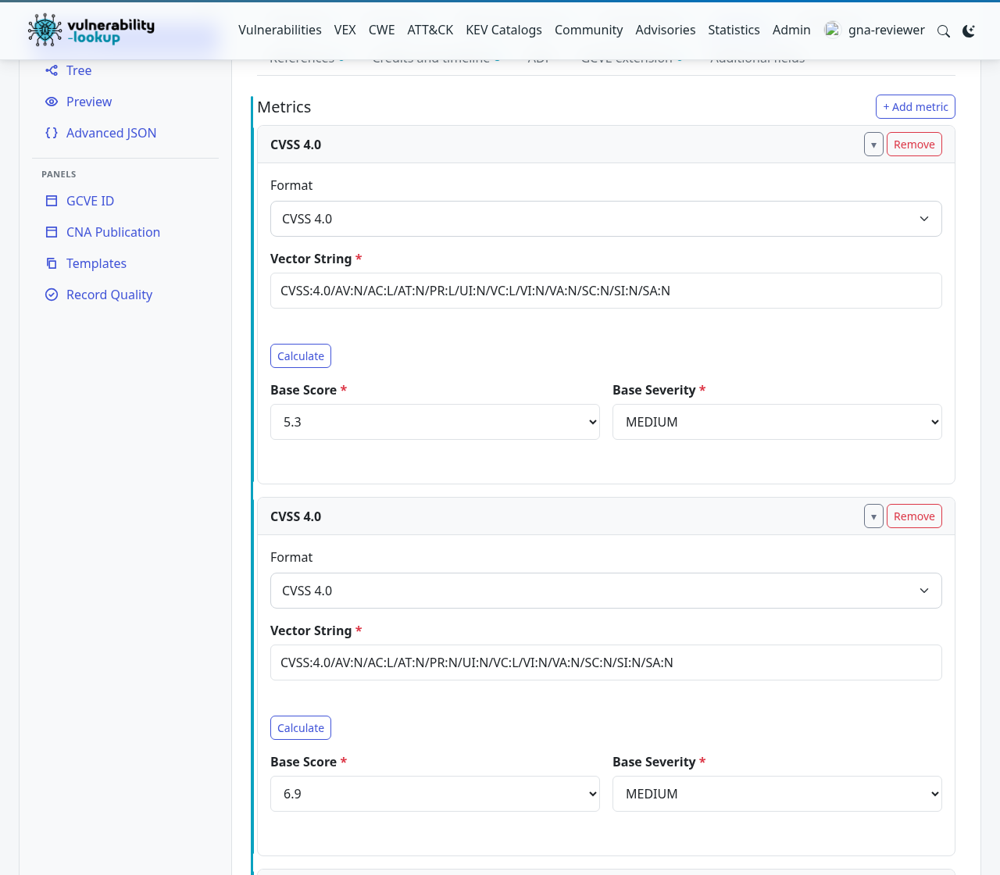
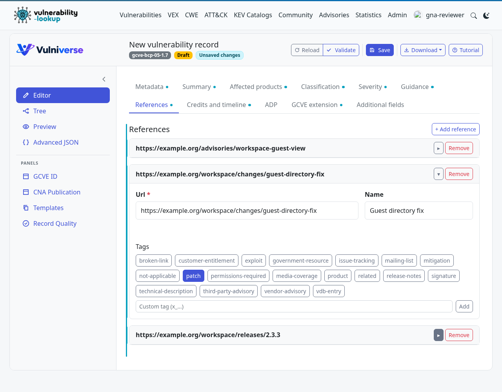
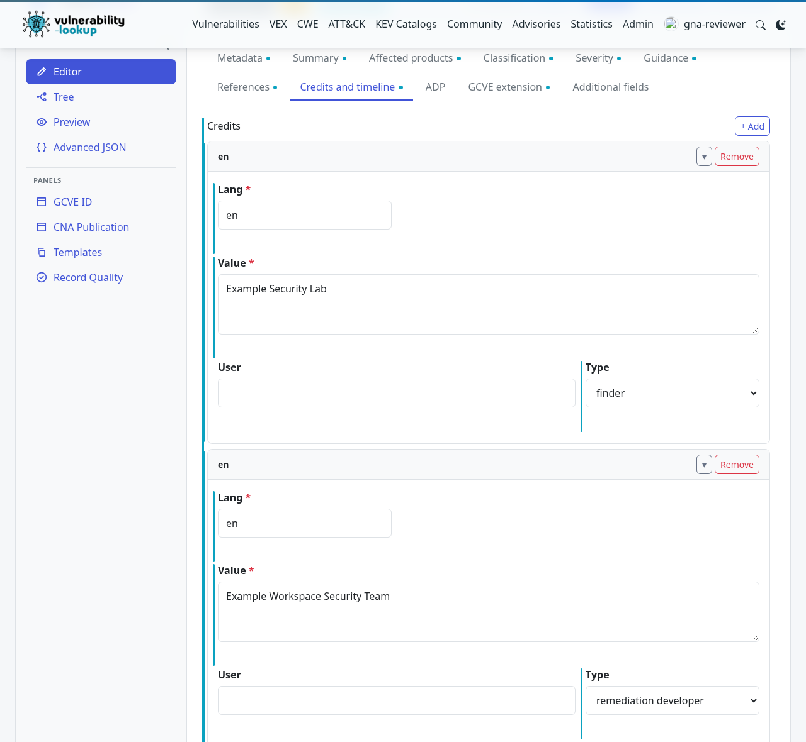
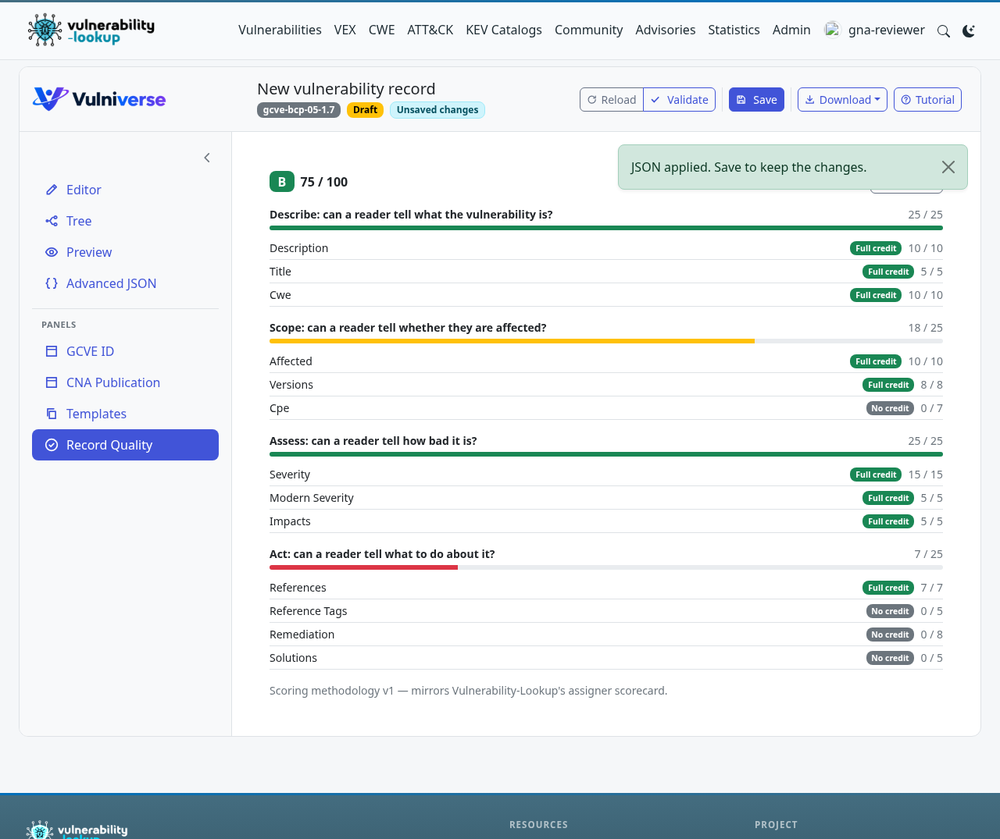
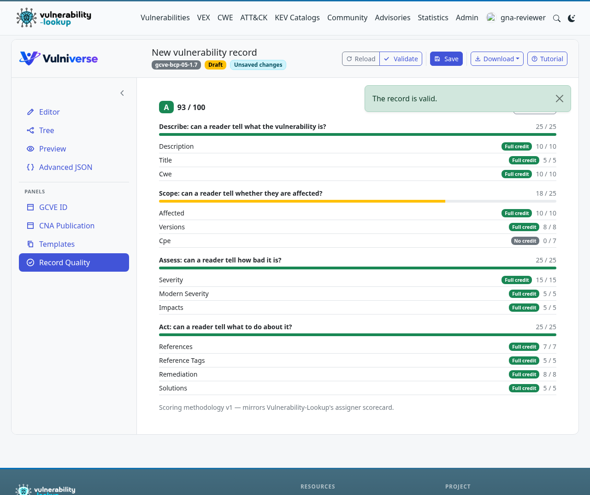

# Write and evaluate a vulnerability record

A good vulnerability record tells readers whether they are affected, what the impact is, and how to protect themselves. Use Vulniverse to turn verified findings into structured fields. Check that the record, the public advisory, and the fix documentation agree before the release.

The walkthrough uses a fictional Example Workspace draft in a local Vulnerability-Lookup 7.1.0 development instance. Its versions, scores, credit names, and URLs illustrate the editor. The separate CPE lookup uses a real catalogue entry to show how to verify a product identifier. [Vulnerability-Lookup revision b4c82c1](https://github.com/vulnerability-lookup/vulnerability-lookup/commit/b4c82c13e40a3e2ee91436ff1c52c9bc7021b50d)

## Prepare the title, description, and affected scope

1. Sign in as a publication operator and open **Advisories → New vulnerability advisory**. Use the CVE or GCVE profile for your publication route. To correct an existing record, open it with **Edit** and retain its identifier.
2. In **Summary**, write a title that names the product or component and the issue. In the description, state the affected behaviour, the relevant conditions, who or what can be affected, and the resulting impact. Use precise version and configuration language. Put private evidence and coordination details in the restricted case.
3. In **Classification**, add the most specific CWE supported by the root cause. For the example, the missing authorisation check justifies CWE-862. Document user impact in the description and add an **Impacts** entry when it adds detail. Add a CAPEC mapping only when the evidence supports the pattern. [CWE-862](https://cwe.mitre.org/data/definitions/862.html) · [CVE Record Format](https://github.com/CVEProject/cve-schema)

   {fig-alt="Vulniverse's Summary tab shows the fictional Example Workspace title and English description in an unsaved draft."}

4. In **Affected products**, use the vendor and product names readers will recognise. Give each independently versioned product or branch its own entry or range. Use the product's version scheme. In the example, `version: 2.3.0` and `lessThan: 2.3.3` mark an affected range with an inclusive start and an exclusive end. Version 2.3.3 is explicitly confirmed unaffected. Leave unverified releases at `unknown` when setting the default status. Check separately for backports and distribution-specific version numbers. [CVE Record Format](https://github.com/CVEProject/cve-schema)

   {fig-alt="The Versions fields in Vulniverse show an affected start at 2.3.0 and an exclusive upper bound of 2.3.3."}

### Look up an existing CPE

1. On **cpe.gcve.eu**, search by vendor and product, and narrow by **Part** for applications, operating systems, or hardware. You can also search by PURL when you know the package coordinates. Open the matching entry and check the exact vendor, product, version, edition, target platform, and deprecation status. If the entry is deprecated, verify that its replacement identifies the affected product. [CPE catalogue search](https://cpe.gcve.eu/)
2. In **Affected products**, add the canonical CPE 2.3 value to the matching product's **CPEs**. Record the affected versions separately and keep them consistent with the advisory. For platform-dependent combinations, use **CPE Applicability** if you can verify the conditions that must hold together. Product and vendor suggestions in Vulniverse depend on the instance's CPE Editor settings. [Vulniverse configuration](https://www.vulnerability-lookup.org/documentation/editor.html#configure-vulniverse)
3. If there is no exact CPE, keep the verified vendor, product, and version data. Add the verified package identity where the schema supports it and propose a catalogue entry if appropriate. The fictional Example Workspace record leaves CPE blank. The screenshot uses a separate catalogue entry. [Mozilla Firefox CPE entry](https://cpe.gcve.eu/cpes/1787341)

{fig-alt="The public GCVE CPE catalogue shows a Firefox application entry and the exact CPE 2.3 string for Mozilla Firefox."}

## Record severity and response priority

### Add a CVSS assessment for each supported scenario

Open **Severity**, select **Add metric**, and choose the CVSS version required by your publication policy. In CVSS 4.0, use **Calculate** or enter the complete vector and corresponding base score and severity. The vector records your assumptions about factors such as access, privileges, and the affected systems. When publishing CVSS 4.0 scores, label the metric groups used. Use CVSS-B for base, CVSS-BT when including threat metrics, CVSS-BE when including environmental metrics, and CVSS-BTE when including both. Explain the context used for threat and environmental assessments. [FIRST CVSS 4.0 specification](https://www.first.org/cvss/v4.0/specification-document)

When assessors disagree, compare the versions, assumptions, and environments behind the vectors. If both assessments describe verified scenarios, create separate metric entries and name each scenario. On the editor revision shown, use **Advanced JSON** to set each metric's `scenarios` list with a language and a descriptive value, then **Apply JSON**. Use **GENERAL** for a baseline intended to apply when no more specific scenario matches. Keep a partner's independent assessment attributed to its source, such as in that partner's own ADP container when it publishes one. For conflicting assessments of the same scenario, record the rationale and agree which assessment the publisher will use. [CVE Record Format](https://github.com/CVEProject/cve-schema)

In the fictional example, the publisher uses two CVSS 4.0 base metrics. Signed-in guest accounts require low privileges (`PR:L`, 5.3). An optional public guest link applies to users without an account (`PR:N`, 6.9). Publish both scenarios with their vectors and scores so users can tell which applies to their deployment.

{fig-alt="The Vulniverse Severity tab shows the fictional record's two CVSS 4.0 metrics, with distinct vectors and base scores."}

### Add an SSVC decision

Use SSVC to record response priority for a named stakeholder role. Choose the decision model that matches the party making the decision. For example, the Supplier model considers exploitation, automatable exploitation, and technical impact. Record the assessment time, the evidence behind each decision point, and the resulting action in your coordination record or advisory as appropriate. The fictional Supplier options below lead to **Scheduled**. Revisit the decision when exploitation evidence or other inputs change. [CERT/CC SSVC Supplier decision model](https://certcc.github.io/SSVC/howto/supplier_tree/) · [Track exploitation in a local KEV catalogue](../kev-catalogue/index.qmd)

For a CVE or GCVE record in this editor revision, use **Advanced JSON** to add a metric with `format` set to `SSVC` and an `other` object whose `type` is `SSVC` and whose `content` is the structured assessment. Add it alongside the existing metrics under `containers.cna.metrics`. Preserve the object structure when editing it. The example below uses the SSVC interchange schema version and the Supplier decision points. Use values supported by your own evidence. [CERT/CC SSVC schema](https://github.com/CERTCC/SSVC/tree/main/data/schema) · [Patch2Vuln's structured output](https://github.com/gcve-eu/gcve-lab-patch2vuln#ssvc)

```json
{
  "format": "SSVC",
  "other": {
    "type": "SSVC",
    "content": {
      "version": "2.0.3",
      "role": "Supplier",
      "timestamp": "2026-11-20T12:00:00Z",
      "options": [
        {"Exploitation": "none"},
        {"Automatable": "yes"},
        {"Technical Impact": "partial"}
      ]
    }
  }
}
```

## Give users a fix and credit the contributors

In **Guidance**, state the first fixed release for each supported branch and how users should obtain or apply it. Document temporary workarounds and their limits. In **References**, use **Add reference** and tag each approved public link for the job it performs.

| Tag | Use it for |
| --- | --- |
| `patch` | A public fix commit, patch, or backport that addresses this vulnerability. Verify that it fixes the affected branch and include an approved backport link when users need it. |
| `vendor-advisory` | The vendor's advisory for this vulnerability. |
| `release-notes` | The release documentation that identifies the fixed version. |
| `mitigation` | Specific instructions that reduce exposure while users prepare to patch. |
| `third-party-advisory` | A separate advisory from a coordinator, distributor, or other third party. |

Link the patch alongside the advisory and release notes when it is public. The patch helps downstream maintainers identify the precise fix, check whether it was backported, and avoid confusing it with a different change in the same release. If the fix is available only through a vendor channel, link the approved advisory or release notes and state how eligible users obtain the fix. Verify each URL while signed out. Keep private tracker and repository links in the restricted case. [CVE Record Format](https://github.com/CVEProject/cve-schema)

{fig-alt="The References editor shows three illustrative links and the patch tag selected for the fix link."}

In **Credits and timeline**, confirm each contributor's preferred public name and role before adding their credit. Distinguish the person who found the issue, the reporter who brought it to the team, and the remediation developer or coordinator where applicable. Respect requests for anonymity and copy only wording approved for publication. Record relevant dates with their meaning, such as discovery, fix availability, and public release. Check credits and dates against the advisory. [GCVE BCP-02 recognition guidance](https://gcve.eu/bcp/gcve-bcp-02/#best-practices)

{fig-alt="The Credits and timeline tab shows fictional finder and remediation developer credits."}

## Use Record Quality to find missing fields

Open **Record Quality** in Vulniverse's sidebar. The panel evaluates the draft in the editor using the Vulnerability-Lookup assigner scorecard rules for CVE and GCVE records. If the panel is hidden, check `panels.record-quality` in `config/vulniverse.json`. Each pillar contributes up to 25 points. Open the panel after edits or click **Recalculate** to see which checks receive full, partial, or zero credit. [Assigner scorecard rules](https://www.vulnerability-lookup.org/documentation/scorecard.html#the-rules) · [Record Quality panel](https://www.vulnerability-lookup.org/documentation/ai-assisted-records.html#record-quality)

| Pillar | What the checks look for |
| --- | --- |
| Describe | A meaningful English description, a title, and a CWE. |
| Scope | Affected vendor and product, version information, and a CPE or applicability block. |
| Assess | A severity statement, a modern assessment such as CVSS 4.0 or SSVC, and structured impact. |
| Act | References, reference tags, a remediation reference, and a solution or workaround. The `patch` tag earns full remediation credit. The `vendor-advisory`, `mitigation`, and `release-notes` tags earn partial remediation credit if a patch link is unavailable. |

The initial Example Workspace draft scores **75/100**. An untagged link earns reference credit and leaves the tag, remediation, and solutions checks empty. After the publisher adds the patch reference, tags the links, and fills in the fix and workaround, **Act** rises from **7/25** to **25/25** and the record reaches **93/100**. The fictional product has no verified CPE, so the **Scope** score stays at **18/25**.

{fig-alt="Vulniverse Record Quality grades the draft B at 75 out of 100. The Act pillar shows 7 out of 25, with no credit for tags, remediation, or solutions."}

{fig-alt="Vulniverse Record Quality grades the improved draft A at 93 out of 100. Act now has full credit, and CPE still has no credit."}

Use the score to find incomplete fields. Verify factual accuracy, reference destinations, applicability, and release approval independently. Credits and timeline details still need a human check. Check **Preview** for what readers will see and use **Validate** to check the format. Keep embargoed drafts in the restricted workflow until release, since **Save** can publish a new local record. After release, check the signed-out record and advisory for the same versions, links, and instructions. [CNA publication](../cna-publication/index.qmd) · [GNA publication](../gna-publication/index.qmd) · [Advisory and follow-up](../advisory-and-follow-up/index.qmd)
